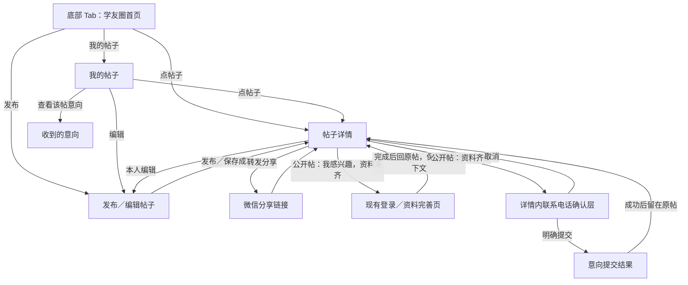

# 会聚｜1.5 学友圈五页面流转与状态草案

状态：五页与确认层首版已实现，工程检查通过，微信工具页面与真机人工验收待进行。业务规则以[1.5 需求草案](学友圈1.5需求草案.md)为准。\
日期：2026-09-30

五个页面与意向确认层的[高保真设计稿](../../设计稿/会聚-学友圈1.5-设计说明.md)已生成，已由用户确定为实现依据，落地页面视觉仍待人工验收；图片中的示例内容不覆盖本文业务规则。

## 页面与入口

| 页面 | 建议入口 | 核心动作 | 页面内状态 |
| --- | --- | --- | --- |
| ① 学友圈首页（新 Tab） | 底部“学友圈” | 按园区资源、运营资源、服务资源、门店浏览；进入详情；发帖；进入我的帖子 | 首次加载、列表、空结果、筛选后空结果、追加中、无更多、首次失败重试、追加失败重试 |
| ② 帖子详情 | 首页、我的帖子、意向记录、微信分享链接 | 看完整内容及 0—6 张图、分享、表达意向；作者进入编辑或查看意向 | 加载、公开可意向、确认意向、提交中、提交成功／失败、已结束、已下架、详情加载失败 |
| ③ 发布／编辑帖子 | 首页“发布”、我的帖子或本人详情“编辑” | 选择类别，填写已确认最小字段，选择图片，发布或保存修改 | 新建、编辑加载、表单未完成、图片选择／上传中、可提交、提交中、失败可重试、发布成功 |
| ④ 我的帖子 | 首页“我的帖子” | 分页查看本人发布内容，进入详情／编辑，标记已结束，查看下架原因与进入意向列表 | 首次加载、列表、空结果、追加中、无更多、失败重试、结束操作中／结果 |
| ⑤ 收到的意向 | 我的帖子中某篇帖子的“查看意向” | 仅发帖者分页查看该帖的意向及提交者留下的联系电话 | 首次加载、列表、空结果、追加中、无更多、失败重试 |

“我感兴趣”的联系电话确认放在②帖子详情的页面内确认层，不额外增加第六页。微信授权登录与完善资料沿用现有页面。管理后台的巡查、下架、恢复另计，不属于这五个小程序页面。首页内“我的帖子”入口及四个 Tab 的具体排列是页面组织建议，可在视觉设计时调整，不改变已确认的业务规则。

## 页面跳转

分享链接中的邀请来源指向**实际分享者**；意向记录指向**发帖者**。仅完整资料的用户能发帖或提交意向。资料补全返回原帖后，只打开确认层，不自动提交。已结束和已下架状态均无“我感兴趣”提交入口；已下架的公开详情只显示下架提示，作者从“我的帖子”查看原因及历史意向。

## 关键状态与失败回路

| 场景 | 展示与允许动作 |
| --- | --- |
| 详情直达、未登录 | 完整浏览公开帖；点击意向再进入微信登录／完善资料，回到同一帖子并等待本人再次确认 |
| 登录中断、取消确认 | 留在原帖；不创建意向；再次点击可重新开始确认 |
| 发布／编辑入口取消完善资料 | 返回学友圈浏览入口，不再次跳入资料完善；成功完善资料仍返回原发布／编辑上下文 |
| 详情下拉刷新 | 重新读取帖子状态与内容；成功或失败均结束刷新指示，页面隐藏或换号后的旧响应不恢复旧内容 |
| 意向提交时帖子结束或被下架 | 服务端拒绝新意向；页面刷新帖子状态。下架后清除已载入的公开正文和图片 |
| 公开帖变为已结束 | 详情仍显示正文、图片及“已结束”；隐藏新意向入口；历史意向仍供作者查看 |
| 公开帖变为已下架 | 非作者只见“内容已下架”；作者在“我的帖子”见下架原因、编辑入口和历史意向，无自行恢复入口 |
| 列表切换类别、下拉刷新 | 清空旧页游标并读取第一页；迟到的旧请求不能覆盖新列表 |
| 列表追加失败 | 保留已显示帖子或意向，提示失败并提供“重试加载” |
| 图片上传失败、发布失败 | 保留已填写内容和已成功上传的图片，允许重试；不得显示发布成功 |
| 无权查看他人意向 | 服务端拒绝；页面不渲染联系方式，也不从其他接口回传该字段 |

## 尚未纳入页面的规则

意向留言、处理状态或通知，已结束帖子能否重新开放，门店官方身份核验，问题帖举报入口及管理员角色范围均未确认。此图不为它们预留假入口；确认后再修订页面与验收条件。
