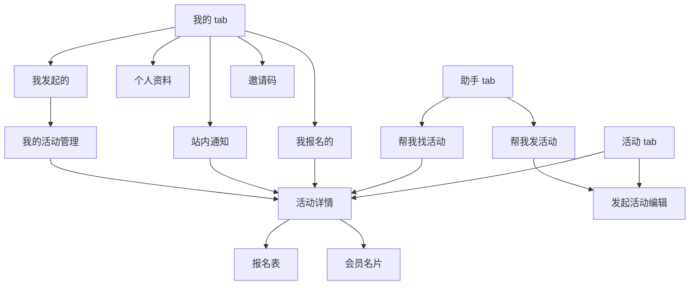

# 有聚点｜小程序框架与导航

状态：导航方案 v0.2  
方案日期：2026-09-24；实现映射更新：2026-09-30

依据：[首期 PRD](首期PRD.md)。本稿确定信息架构和跳转，不定义视觉稿或技术实现。

2026-10-19 身份规则更新（已确认并实现；工程与真实微信／数据库验收分层见 10 月实现日志）：进入先静默识别，全新及三项资料未全者均为游客；可浏览，不强制进完善页，业务操作时再引导。完整会员自动恢复。邀请码在首次建身份时固定，完善页只展示来源、不允许改上级；协议同意与静默识别分离。历史实现段的旧身份时序由本规则替代。

## 1. 导航结论

首期历史方案为三 Tab。当前 1.5 已按用户确认实现四个入口，顺序固定为 **活动｜学友圈｜助手｜我的**，默认进入“活动”；学友圈规则见下方 1.5 节。

当前客户“学加”的页面运营文案：活动页「连接资产运营人才，共建共享“学加”学友生态」；助手页「“学加”活动智能助手」。这是可配置文案，后台可修改；后台指定的“平台管理员”也可在小程序前端修改。tab 名称仍为“活动”“助手”“我的”，页面原生标题不在内容区重复。

| Tab | 首屏任务 | 主要内容 | 不放在此处的内容 |
| --- | --- | --- | --- |
| 活动 | 找到活动、查看、报名 | 活动列表、活动推荐入口、发起活动入口 | 完整报名表、活动管理页 |
| 助手 | 快速发活动或找活动 | “帮我发活动”“帮我找活动”两项任务入口 | 只有空输入框的纯聊天页 |
| 我的 | 管理个人资料和自己的活动 | 资料、我报名的、我发起的、站内通知、邀请码 | 平台管理员后台 |

活动发起可以从“活动”页直接填写，也可以从“助手”页让 AI 草拟后进入同一编辑流程。AI 不自动发布活动。

首期不设置独立“资源”tab 或会员目录页。点击活动阅读留痕、报名列表中的头像进入会员名片；名片展示字段由会员设置，并受 PRD 的资料权限约束。

## 2. 页面层级

### 一级页面：tabbar

| 页面 | 主要区块 | 关键动作 |
| --- | --- | --- |
| 活动 | 可配置运营文案；活动列表；免费/收费标识；可见的推荐活动；发起活动入口 | 打开活动详情、发起活动、切换到助手 |
| 助手 | 可配置运营文案；帮我发活动；帮我找活动 | 生成可编辑活动草稿、查看有理由的推荐活动 |
| 我的 | 资料完成状态；我的名片设置；我报名的；我发起的；站内通知；邀请码 | 维护资料、设置名片展示、管理自己活动、查看通知 |

### 二级及后续页面

| 页面 | 主要进入路径 | 主要动作或内容 |
| --- | --- | --- |
| 活动详情 | 活动列表、推荐结果、我的活动、站内通知、微信分享 | 活动信息、阅读留痕、报名列表、评论、点评、分享、报名 |
| 报名表 | 活动详情 | 本次联系手机号、自定义问题答案；提交或返回 |
| 报名结果/我的报名详情 | 报名提交后、我的报名 | 查看报名状态、截止前修改答案、活动开始前取消报名 |
| 发起活动编辑 | 活动页直接发起、助手生成草稿 | 选择免费/收费模式，填写固定金额和活动咨询联系方式，编辑活动信息与自定义报名问题、发布 |
| 帮我找活动 | 助手页同名入口、活动页“推荐” | 完整会员输入需求、查看理解条件和每批最多3个推荐、补充条件或查看更多；游客操作时先完善三项资料 |
| 前端运营文案编辑 | 仅后台指定的平台管理员可进入 | 修改活动页与助手页运营文案；普通会员不可见且无修改权限 |
| 我的活动管理 | 我的发起的活动 | 查看报名、浏览与转化数据、手动签到、取消活动 |
| 个人资料与名片设置 | 我的；受限操作的补全引导 | 绑定手机号、填写头像和用户名称、维护其余资料、逐项设置名片展示并预览 |
| 会员名片 | 点击活动发起人、阅读留痕或报名列表中的头像 | 按会员设置和访问权限展示其资料 |
| 站内通知 | 我的 | 查看已报名活动的取消、下架、恢复通知并进入活动状态页 |
| 邀请码 | 我的 | 查看自己的邀请码及邀请相关入口 |

页面名称是导航工作名，最终文案可在页面设计时调整。小程序原生导航栏承担页面标题，页面内容不重复放同名大标题。

## 3. 关键跳转

### 分享进入

微信好友、群或朋友圈分享活动 → 活动详情。分享入口带活动标识与邀请码；首次有效邀请绑定规则按 PRD 执行。活动详情作为分享落地页，用户未完善资料时也能查看活动、阅读留痕与报名列表。活动被下架时，旧分享入口展示下架状态。

2026-10-05已接入活动详情朋友圈分享：详情页右上角菜单同时开放好友与朋友圈；朋友圈使用当前公开详情页及`id`／`inviteCode`查询参数，好友分享使用同一参数生成详情路径。只携带当前分享者的邀请码，不继承上游邀请来源、推荐查询或报名归因凭据。管理页通过既有“查看活动”进入公开详情后分享朋友圈，避免朋友圈固定落地当前管理页。2026-10-19 新规则替代原匿名暂存到主动登录的时序：进入捕获来源并静默识别，首次建身份即绑定；已有邀请保持不变。代码、编译与替身回归已通过，真实朋友圈单页及正式进入小程序后的邀请绑定仍待真机验收。

### 资料补全拦截

报名、发起活动、评论、点评、AI 草拟和 AI 找活动等业务动作是受限操作。缺少绑定手机号、用户头像或用户名称时，先进入个人资料补全；完成后返回原活动或发起流程，避免丢失当前上下文。平台默认头像和用户编号名称不能通过门槛。

取消完善资料与完成后的返回分开处理：取消时可返回公开详情或对应浏览入口，不返回会自动再次触发资料门槛的受限编辑页；完成后仍恢复原操作上下文，不自动提交业务动作。

### 助手任务

- **帮我发活动：** 在一个普通输入框输入整段活动想法（可用系统输入法语音输入）→ 主动点击“生成草稿” → AI 草拟并映射已明确的字段 → 直接进入现有发起活动编辑页 → 发起人补齐、检查、修改并手动发布。不单独增加预览页或录音入口；直接填写活动的路径继续可用。生成前按发起活动的资料门槛引导补全；生成失败保留输入并提供手动重试，达到当日 5 次成功生成上限时提示。

2026-09-30 实现映射：助手卡片进入 `pages/assistant/activity-draft`，生成成功后进入既有编辑页；`0006` 已于 2026-09-29 获授权应用于本机开发库，后端 AgentIsHere / `gpt-5.5` 已完成真实调用。微信开发者工具以模拟会员身份验证了标题、介绍、明确日期、地点、人数、收费金额与报名问题的回填，未保存或发布测试活动。真实微信身份、真机及真实数据库并发限额仍未验收；详见[实现日志](../implementation-log/2026-09.md)。

- **帮我找活动（2026-10-02已接入代码，人工验收后置）：** 助手页及活动页“推荐”进入`pages/assistant/activity-search` → 仅完整会员可操作，游客先完善三项资料 → 输入需求 → 展示理解条件、每批最多3个活动及理由 → 查看详情 → 按现有完整资料门槛报名。输入为主、补充资料在站内辅助；完善必填资料返回后保留本次会话，不自动检索。补充条件重新检索，查看更多追加3个，不重复调用AI；本次会话无历史列表。默认可报名范围、额度、错误及归因见[专项需求](智能活动推荐.md)。页面及原生标题已注册，推荐迁移与真实模型尚未执行。

## 4. 权限和状态对导航的影响

| 状态 | 导航处理 |
| --- | --- |
| 游客（全新或三项未全） | 可打开活动详情及两类公开列表；点击头像查看完整名片与受限操作时引导补全资料 |
| 资料已完善 | 可报名、发起、评论；活动结束且已签到后可点评；可查看其他会员允许公开的资料 |
| 活动报名截止或报满 | 活动详情仍可查看，报名入口展示对应不可报名原因 |
| 活动取消或下架 | 活动详情展示状态；按 PRD 禁止对应新操作；已报名者从“我的 → 站内通知”查看变动 |
| 助手无合适推荐 | 给出继续浏览活动的入口，不用空白聊天框代替结果 |
| 我的尚无报名或发起活动 | 对应列表显示清楚的空状态和“去看活动”或“发起活动”入口 |

二级页面的主要提交按钮和底部操作需避开手机安全区域；具体位置在视觉稿中确定。

## 5. 资源与需求的可发现性

首期不增加独立资源目录。用户在活动的阅读留痕、报名列表中点击头像，可进入该会员名片，查看其选择展示的资源、需求等资料。未完善资料的浏览用户只能看到列表中的头像和名称，不能打开完整名片。

名片始终显示头像和用户名称；家乡、简介、资源、需求、真实姓名、邮箱、绑定手机号分别由会员控制是否展示，首次均默认关闭。会员可主动逐项开启，设置前可预览名片；公开范围限于已完成三项必填资料的其他会员。

**设计风险：** 资源与需求目前只有通过活动参与者列表才容易被发现。页面设计时可在列表附近提示“点击头像了解同学”，但不增加新的权限或目录功能。上线后的实际浏览路径与资料填写情况，需要用使用数据判断是否值得建立独立“资源”入口。

## 6. 当前实现与验证边界（2026-09-30）

- 框架覆盖：3/3 个已确认 tab；活动分享进入、报名、发起、会员资料、站内通知均有路径。
- 已核对：未完善资料仍能看活动；头像和名称全平台统一；站内通知放在“我的”；管理员后台不混入小程序 tabbar。
- 已实现：活动列表左图右文卡片、报名头像、服务端分页与触底追加；三步活动编辑、封面上传、管理、阅读统计、签到、评论/点评；个人资料、名片设置与预览、站内通知和邀请码入口。活动列表分页与参与费用输入框已获用户视觉反馈通过；其余证据按下方索引区分，不代表全部人工验收。
- 名片采用已确认 v3 稿，分区顺序为个人信息 → 我有资源 → 我需资源 → 个人简介；页面和预览共用组件，只展示获准字段，整个分区无可见字段时隐藏。2026-09-30 微信工具已验证资料保存、预览、开关保存及活动发起人名片入口，测试资料与设置已恢复原值。
- `pages.json` 当前注册 23 条路由（含学友圈五页）；原生标题由该文件统一配置。实际页面及分层证据见[实现日志](../implementation-log/2026-09.md)，设计对应关系见[生成记录](../../设计稿/生成记录.md)。
- 运营文案编辑已有代码；2026-10-05已补富文本、地图选点与自定义报名须知代码，新增0011迁移尚未执行，微信工具与真机暂不验收；不得把代码交付表述为环境已开放。2026-10-02帮我找活动已接入代码与契约，推荐运行环境仍待迁移及单独验证。2026-09-30 已补公开报名名单、我的报名、我发起的、管理名单与通知分页，以及阅读/反馈触底追加与错误重试；全量统计由服务端提供。活动详情的本人报名查询失败独立重试，不遮挡公开内容。该轮属于代码与 L1 交付，真实库多页数据、微信工具和真机尚需验收。
- 待真机验证：微信分享及朋友圈单页模式、手机号授权、头像昵称填写、底部安全区域与实际返回路径。

上文信息架构描述产品目标；本节描述当前实现边界，不能用路由存在替代业务或真机验收。

## 1.5 学友圈导航补充（首版实现，人工验收待进行）

1.5 已实现“活动｜学友圈｜助手｜我的”四 Tab；现有页面仍承担原有职责。学友圈路由为 `pages/circle/{index,detail,editor,mine,intents}`，确认层在 detail 内；本人作者从我的帖子进入编辑/结束/意向，公开详情支持实际分享者邀请来源。

学友圈列表进入帖子详情；详情可以对外分享。分享访客可完整浏览公开帖，点击“我感兴趣”后经现有微信登录与资料完善流程返回原帖，由本人再次确认提交。发帖、本人帖子及意向查看从学友圈进入；最小字段见[1.5 需求草案](学友圈1.5需求草案.md)，五页面跳转与状态见[页面流转草案](学友圈1.5页面流转草案.md)。已下架帖子从旧分享链接进入时只显示下架状态，已结束帖子显示内容与结束状态，两者均不提供新意向入口。

## 历史实现映射（阶段快照）

以下保留各阶段的实现过程；其中“未实现”“待执行”等状态仅对应当时，以第 6 节与最新实现日志为准。

2026-09-27开发映射：活动页“发起活动”进入`pages/activity/editor`；我的“我发起的”进入`pages/activity/organized`，列表进入`pages/activity/manage`查看私密报名名单、编辑/发布/取消；我的“站内通知”进入`pages/notification/index`，通知链接返回活动详情。编辑页资料补全返回时保留活动ID与本人表单。此轮覆盖人工发起、管理和活动变动通知，AI草拟、签到、浏览统计和管理员处置仍另行实现。证据层级见实现日志，不将路由存在等同真机验收。

### 最小链路实现边界（2026-09-26 历史快照）

已注册8条路由：登录兼资料补全、活动/助手/我的三个Tab、活动详情、报名表、报名详情、本人报名列表。页面入口使用真实API或明确未开放提示；不把本文完整导航设计当作已经实现。助手、发布管理、名片设置、站内通知、评论和阅读留痕不在当前实现闭环内。原生标题由pages.json统一配置；人工视觉与真实微信验收集中后置，范围和证据见根HANDOFF与资源清单。

2026-09-27基本信息页视觉映射：`pages/activity/editor`内第一步按《会聚-发起活动页-高保真.png》排列九块信息卡片；下一步显示既有报名问题编辑，返回保留表单。导航标题统一为“发起活动”。本轮用户确认仅布局复刻，封面上传/富文本/地图选点标明未开放，报名设置与确认发布两张设计稿的精细复刻后续进行。封面、人数、截止时间仍按PRD选填。

2026-09-27第二步接续：报名设置页已按第二张设计稿调整卡片及列表，人数、截止时间与第一步共享数据，自定义问题支持弹层编辑和排序。报名须知暂未开放，需要报名保持开启。

2026-09-27第三步接续：确认发布页展示活动预览、介绍、报名设置及其他信息，使用当前表单及会员数据，可返回对应步骤编辑。勾选核对信息后才能进入既有发布确认弹窗；没有正式发布规范文档时不虚构协议，入口为费用与发布说明。三步按微信开发者工具实际显示调整 rpx 字号、输入框和安全区，人数及截止设置改为上下布局保障可读性。后续小程序 UI 统一在微信开发者工具验收。

2026-09-27封面能力更新：用户确认使用后端本机存储后，基本信息页已支持选择PNG/JPG、上传、更换及点击预览，确认页读取当前未保存封面，保存后通过真实活动接口回显。封面仍选填，图片上限2 MiB；上传失败保留旧封面，取消选图不提示错误。富文本与地图选点仍未开放。

2026-09-27活动详情视觉映射：按《会聚-活动详情页-高保真.png》调整封面、概要、介绍、报名信息、头像名单和底栏，名单首行最多8人，可展开接口返回名单。阅读留痕随后接入独立接口（本地迁移与微信工具模拟身份验收已完成），评论仍未开放；不显示设计稿虚构的计数、评价或多图页码。原生导航和报名/咨询权限继续沿用。

2026-09-27扫码入口：活动页搜索框右侧“扫码”调用微信scanCode，识别后进入既有活动详情。当前接受`/pages/activity/detail?id=<UUID>&inviteCode=<可选邀请码>`（也可省略开头斜杠）以及`huiju://activity/<UUID>?inviteCode=<可选邀请码>`普通二维码内容；只传入校验后的id/inviteCode，不允许其他路由、重复参数或任意网页跳转。取消无提示，识别失败/不支持码弹窗说明。活动不存在和下架沿用详情真实API与状态，已报名者显示查看我的报名。没有正式AppID前不生成微信小程序码、不接任意HTTPS链接/scene短码；普通测试码仅供小程序内部扫码，不代表微信外部扫一扫可直接打开小程序。

2026-09-27阅读留痕映射：详情页独立显示阅读会员头像/名称，首行8人，可展开与分页；浏览次数、人数及转化率只在发起人管理页显示。阅读失败独立重试，不阻断活动内容与报名。会员名片仍未实现，本轮不扩展该入口。代码与 L1 已完成；0003 已授权在本机开发库执行，阅读名单及统计已在微信工具以模拟身份/真实本地数据验收，真实微信及真机仍未验收。

2026-09-27补充页面：我的“我的邀请码”进入`pages/invitation/index`，读取本人当前邀请码并支持复制，活动入口使用switchTab返回活动页；未增加邀请人列表、二维码或返利。站内通知按新增设计稿调整，继续使用既有通知接口和标读/活动跳转。个人资料、名片设置、会员名片新增设计稿已保存，页面与字段权限后端仍待实现，不等同已开放。

2026-09-27个人资料与名片：我的→个人资料（`pages/member/profile`）编辑头像、名称及六项选填资料；绑定手机号仍通过既有登录与完善资料页。我的/资料页→名片展示设置（`pages/member/card-settings`），七开关默认关闭，保存前在当前页弹层预览。活动详情的发起人、报名名单、阅读名单头像→会员名片（`pages/member/card?id=会员UUID`），完整度不足引导补全；直接打开同样受API门槛限制。首页仍为活动Tab。新页面L1与数据库验证见实现日志，微信/真机验收单独记录。

2026-09-28我的活动与报名详情：保留我发起/我报名两条已存在路由，统一原生标题“我的活动”，顶部切换用replace避免层层堆栈。列表按活动开始/结束时间筛选，取消/下架优先，发起列表另含草稿；卡片使用真实封面、报名/容量/费用，不显示无接口的浏览量，不开放取消后重新发布。报名详情按原稿重排概要、状态、动态答案、咨询与操作说明，咨询自由文本只提供复制。隐藏、换号、卸载清除私密资料；取消确认在原身份和页面代次仍有效时才发送。

2026-09-28 F06开发映射：活动详情“评论与点评”→pages/activity/feedback?id=活动UUID；页面按真实接口展示评论/点评、我的历史、本人修改删除与发起人评分汇总，表单用本页弹层。活动管理名单增加“标记到场”确认及有效到场数。原生标题“评论与点评”，固定尺寸rpx。数据库0004尚未执行，微信工具业务验收待授权后进行；后台审核待身份方案确认。

## 2026-10-04 运营文案与协议入口

- 活动与助手页面进入时读取统一平台文案；“我的”向获授权会员显示`pages/platform/content`运营文案设置入口，其他会员不显示，服务端每次保存仍校验授权。
- 登录前和“我的”均可打开`pages/legal/terms`、`pages/legal/privacy`。2026-10-19 规则替代原同意后登录时序：静默识别不代同意，完善页默认不勾选，主动同意提交当前协议版本；手机号与头像分别由本人授权。正文为开发占位，正式资料后补。
- 确认规则与数据边界见[后台运营与协议流程](后台运营与协议流程.md)。0010迁移生成不代表已启用；本轮分层验证见当月实现记录。

2026-10-05活动编辑能力更新：第一步活动介绍接入原生editor，支持B/I/U与有序／无序列表，纯文本10000字、格式片段1000上限；地图选点仅用户点击后调用，地址仍可手填。第二步报名须知选填500字，第三步确认预览及公开详情／报名填写页回显。安全Delta持久化，不直接渲染HTML；旧纯文本和AI草稿兼容。活动开始后两字段继续锁定。0011迁移未执行，微信主体位置接口权限、隐私声明与真机效果尚未核验；用户本轮暂缓人工验收。

2026-10-05 19:12后接续：0011已获授权应用于本机huiju，迁移12条。真实HTTP＋MySQL回滚20项通过；微信工具已查看详情格式／须知、输入6字并选区加粗及三步切换。地图窗口未打开，须知编辑保存／报名页和真机尚未完成，不将本机代码交付或部分微信检查称为三项全部验收通过。后续状态详见本月实现记录。

### 2026-10-19 注册登录页视觉更新

用户确认采用[注册登录页 v2](../../设计稿/会聚-注册登录页-高保真-v2.png)，替代原登录页视觉。`pages/login/index` 原生标题为“注册与登录”，头像、用户名称、手机号和邀请来源同页展示（邀请码输入仅保留未绑定情形，已固定来源只读），协议勾选与两个链接同一行且默认不选；未建立会话时主按钮为“注册 / 登录”。头像选择可先保留本页预览，昵称通过微信 nickname 输入及原生表单提交读取；手机号由本人点击授权。身份交换按最新静默规则进行，协议同意仅由本人主动提交；手机号绑定仍须本人主动授权且本页明确同意，不要求额外点击“先微信登录”。这不将手机号改为登录账号，也不新增短信验证码或手机号自动合并会员；AI 找活动同步要求完整会员，撤销旧仅登录例外。

### 2026-10-27 我的报名详情调整（用户确认）

报名详情标题、时间、地点、本人报名信息和咨询文本可长按选择；时间点击打开系统日历确认及提醒选择，默认提前1小时。地址有坐标时打开微信地图，无坐标就地提示补充。概要底部左侧头像和用户名进入现有名片页，右侧“查看详情”进入对应公开活动；咨询复制按钮独立成行。发起/编辑选点同时保存坐标，手动改址清空旧坐标并提示重新选点。未新增页面，小程序内工作日历不在本批范围。

本地0012已迁移；类型、测试、编译及部分微信工具交互检查通过，真实手机日历写入/提醒、地图选点与导航和长按复制仍待真机验证。用户已确认本批交付，不代表真机能力或远程部署验收。

## 2026-10-28 名单页面更新（当前规则）

本节替代历史映射中的“在活动详情页展开名单”。详情保留最多8人预览，1人即有“查看全部”文字入口（无箭头），0人显示空态。

| 入口 | 路由 | 页面与交互 |
| --- | --- | --- |
| 活动详情已报名、我的报名详情查看报名名单 | `pages/activity/people?id=活动UUID&kind=roster` | 报名名单，头像/名称、名片入口；触底分页，每页20条 |
| 活动详情阅读留痕 | `pages/activity/people?id=活动UUID&kind=readers` | 阅读留痕，头像/名称、名片入口；触底分页，每页40条 |

共用页面按kind设置原生标题，返回上级页面；下拉刷新重置第一页，追加失败可重试并保留已有数据，末页显示“没有更多了”。不改变会员名片访问门槛，不暴露报名联系方式及答案。

## 2026-10-28 发起活动填写项更新

沿用`pages/activity/editor`的“基本信息→报名设置→确认发布”流程，不新增页面。报名设置中的添加/编辑弹层提供常用填写项，填写项名称获焦展开本人历史配置（每页20条，独立滚动触底追加/加载更多、失败重试及收起）。选择后带入当前副本，保存填写项返回报名设置，保存活动后才进入跨活动历史。手机联系方式仍为一个系统必填字段；复制配置不复制报名答案、历史ID或必填标记。

弹层内部明确阻止点击冒泡，遮罩和取消可关闭；取消不保存当前弹层修改。会话变化、关闭弹层、隐藏及卸载页面清理历史并拒绝迟到响应。开发者工具交互及本地持久化验收见10月日志，真机键盘仍单独验收。

## 2026-10-28 分享入口与目标

| 当前页面 | 分享目标 | 好友/群 | 朋友圈 |
| --- | --- | --- | --- |
| 活动、学友圈、助手首页 | 各自首页 | 开放 | 开放 |
| 活动详情、帖子详情 | 当前公开内容 | 开放 | 开放 |
| 我的报名详情、活动管理 | 对应公开活动详情 | 开放 | 关闭 |
| 编辑表单、通知及其他个人管理页 | 不新增分享 | 关闭 | 关闭 |

以上开放均以当前身份识别成功、本人邀请码及可分享内容已就绪为前提；草稿/下架内容关闭。失败提示“重试分享”，正常浏览保持。卡片采用已有公开园区图片，避免私密页截图。分享参数仅id/inviteCode，无新增页面。

## 2026-10-28 个人资料与名片字段

沿用pages/member/profile、card-settings、card及MemberCard组件，无新增页面。资料页新增微信号、个性标注、二维码上传/更换/移除；二维码即时保存提示与错误重试可见，文字随“保存资料”提交。名片设置分别控制微信号/二维码/个性标注，默认关闭；预览遵循同一白名单。名片名称下显示个性标注，联系区提供微信号复制及二维码放大，空值隐藏。

资料页输入采用原生adjust-position及130px cursor-spacing，keyboardheightchange提供底部滚动空间，键盘展开时隐藏固定保存栏，收起/离页恢复；不叠加整页固定上移。该像素间距是实施初值，iOS/Android真机表现仍须复核。
## 2026-10-28 首页广告与介绍页面

第18、26项采用确认稿：活动/助手2:1轮播、学友圈3:1轮播，点击广告进入pages/advertising/introduction?id=介绍ID；仅传内容ID，不传联系方式。该页为公开阅读页，展示封面、名称/企业、介绍图文、联系人、公开电话/微信及复制/拨号确认；不存在或下架显示不可用，网络失败可重试。本批不扩展介绍页分享能力，已有首页分享门控保留。

我的顶部3:1单张背景不可点击，头像、用户名及编辑资料入口保持。轮播5秒、手动横滑、离页暂停；无广告使用原品牌图，单图不自动滚动；分页预加载后续数据，只有当前和相邻图片挂载。既有列表、搜索、两个助手与TabBar不重做。

后台新增/advertising入口，提供广告列表、介绍内容列表和我的背景设置；广告和介绍编辑、预览、裁剪为同页管理流程。确认稿仅约束本批区域；实现验收层级见当月日志。
