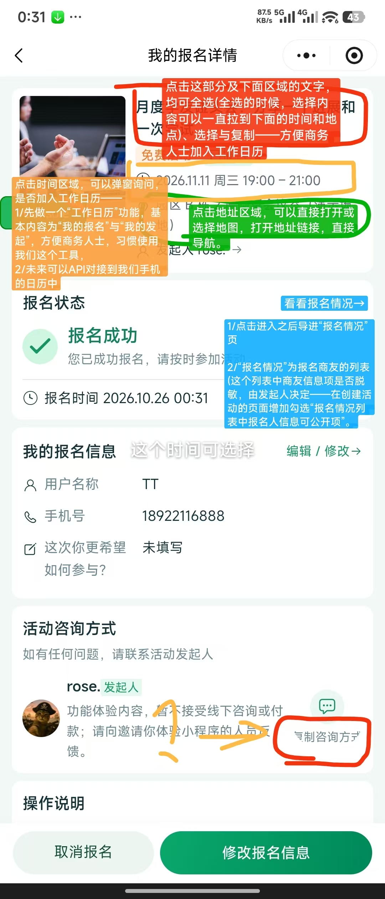
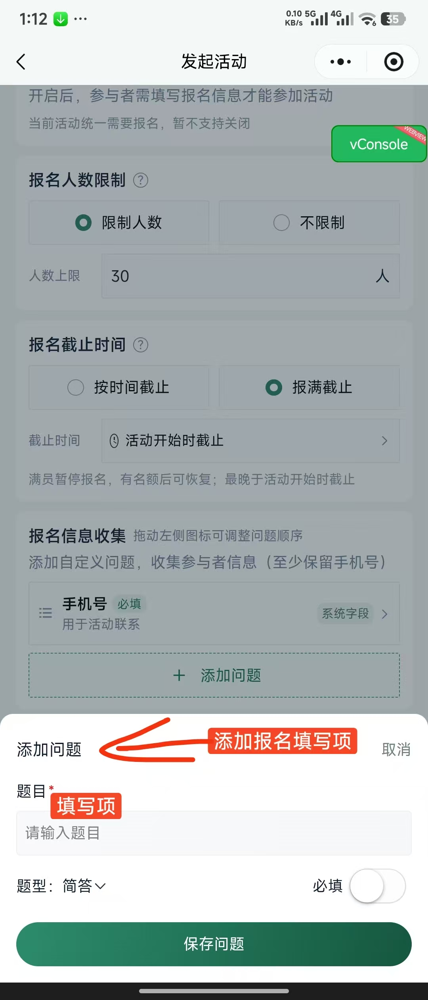
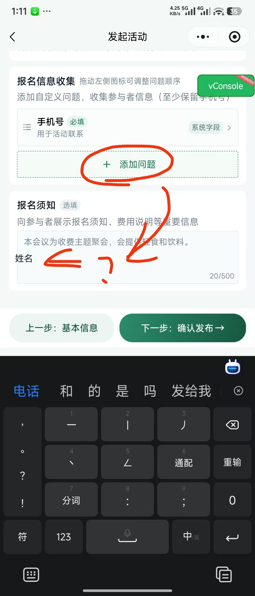
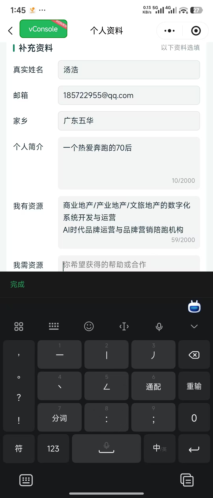
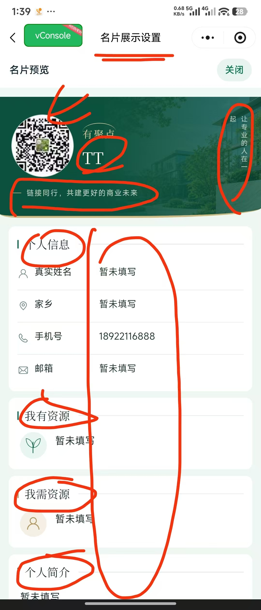
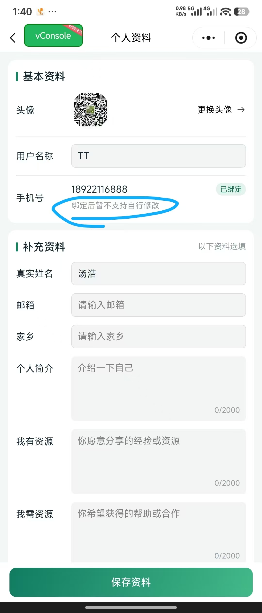
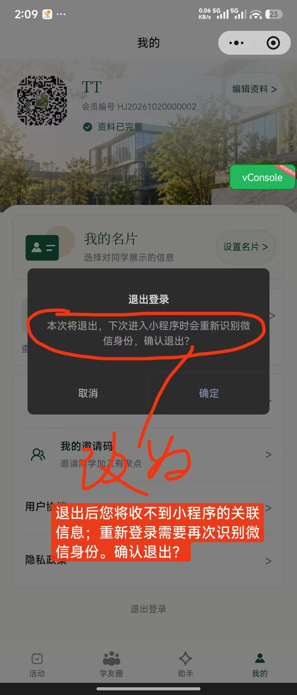
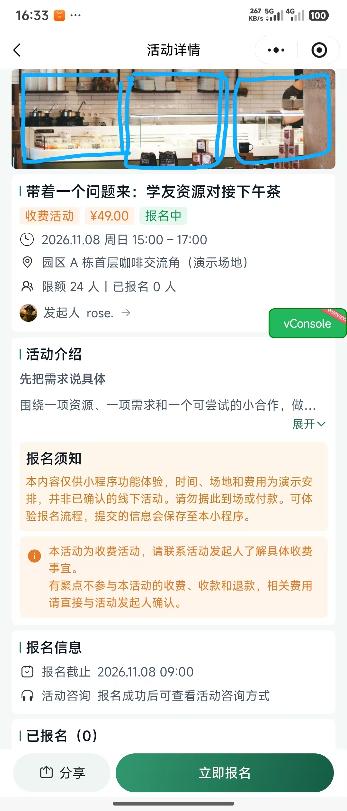

# 老板需求收集

创建日期：2026-10-26

状态：2026-10-27 本轮暂收录至第 28 项，转入逐项方案讨论；保留原始内容，后续新增需求继续追加。

## 收录方式

- 按接收顺序编号，每条保留老板需求原文及对应图片。
- 图片保留收到的原始文件，不压缩、不裁剪、不重绘；保存到 `docs/资源/原始图片/老板需求/`，并在对应条目中嵌入图片、附原文件链接。收到图片时再创建目录。
- 补充说明、需求分析和待确认问题单独标注，不混入原文。
- 本文是原始需求记录，确认后的产品规则再同步到对应正式文档。

## 需求记录

### 1. 重新设计有聚点 Logo，提供两三个方案供选择

**需求原文：**

> 1/有聚点那个logo不匹配我们，如我们的智能体方向的创新与引领等。
> 请再重新按照这个新的名字，让AI帮忙设计两三个，我们做个选择[抱拳][抱拳]

### 2. 活动文字支持全选、选择与复制

**需求原文（本批次“一”）：**

> 点击这部分及下面区域的文字，均可全选(全选的时候，选择内容可以一直拉到下面的时间和地点)、选择与复制——方便商务人士加入工作日历

对应图片：本批次原图 2，红色批注区域。

### 3. 工作日历与时间区域入口

**需求原文（本批次“二”）：**

> 点击时间区域，可以弹窗询问，是否加入工作日历——
> 1/先做一个“工作日历”功能，基本内容为“我的报名”与“我的发起”，方便商务人士，习惯使用我们这个工具，
> 2/未来可以API对接到我们手机的日历中

对应图片：本批次原图 2，黄色时间区域及橙色批注。

### 4. 地址区域操作

**需求原文（本批次“三”）：**

> 点击地址区域……

**图片批注补充（原图 2，绿色批注）：**

> 点击地址区域，可以直接打开或选择地图，打开地址链接，直接导航。

### 5. 报名情况列表与信息公开项

**需求原文（本批次“四”）：**

> 1/点击进入之后导进“报名情况”页
>
> 2/“报名情况”为报名商友的列表(这个列表中商友信息项是否脱敏，由发起人决定——在创建活动的页面增加勾选“报名情况列表中报名人信息可公开项”。

对应图片：本批次原图 2，“看看报名情况→”入口及蓝色批注。

### 本批次图片中的其他批注

以下仅转录图片批注，与上述文字原文分开保留；含义尚不明确的内容待补充。

- 原图 1，报名问题：蓝色批注“（可多选）”；绿色批注“其他：____（点击后可输入文本）”。
- 原图 2，“我的报名信息”标题旁：白色批注“这个时间可选择”（所指时间及具体操作待补充）。
- 原图 2，“活动咨询方式”区域：圈出“复制咨询方式”，旁有问号及箭头（具体诉求待补充）。

### 本批次原始图片

接收日期：2026-10-26。两张图片均从附件原文件直接复制保存，未缩放、压缩、裁剪或重绘；保存副本与附件源文件的 SHA256 一致。

**原图 1：报名表批注**

[查看原始文件](../资源/原始图片/老板需求/codex-clipboard-8cdaaf94-e84a-40cd-ba9e-0a6c8835c9c5.jpg)

**原图 2：我的报名详情批注**

[查看原始文件](../资源/原始图片/老板需求/codex-clipboard-ac11c185-9157-4edb-8594-0d64d0f6cada.jpg)

### 6. “添加问题”填写异常，需测试

**需求原文（本批次说明及“1/”）：**

> 这个BUG的意思是，
>
> 1/“添加问题”功能失效，请测试一下。
> 目前看到的问题是填写不了，填写的区域和下面搞混了。

对应图片：下方本批次原图 1、原图 2。状态：用户反馈，待测试复现；尚未验证原因或修复。

### 7. 明确报名填写项含义，增加系统默认项

**需求原文（本批次“2/”及“A.”）：**

> 2/这个添加问题应该是指添加报名填写项？所以——
> A.应该预设多几个报名一般要填写的“系统默认项”，如：
> 手机
> 姓名或昵称
> 性别
> 公司或组织
> ……

**图片批注补充（本批次原图 1）：**

- “添加问题”标题旁标注“添加报名填写项”。
- “题目”输入区域旁标注“填写项”。

### 8. 创建过的报名填写项支持记忆与下拉复用

**需求原文（本批次“B.”）：**

> B.创建之后，创建项目都有记忆，在填写栏点击之后，下拉可以看到之前的记忆项，方便创建者快速填写。

### 第 6～8 点原始图片

接收日期：2026-10-26。两张图片均从附件原文件直接复制保存，未缩放、压缩、裁剪或重绘；保存副本与附件源文件的 SHA256 一致。

**本批次原图 1：添加问题弹层及命名批注**

[查看原始文件](../资源/原始图片/老板需求/codex-clipboard-65fc882b-34ba-4df7-a0b4-96c1b09cc18a.jpg)

**本批次原图 2：输入区域与报名须知区域混淆反馈**

[查看原始文件](../资源/原始图片/老板需求/codex-clipboard-cc1de282-53a8-4412-8d94-86d9d84c1f44.jpg)

### 9. 所有分享携带邀请来源，建立上下关系链路

**需求原文（本批次说明及“1/”）：**

> 分享的功能要细化（目前好像主要是有分享键的才能分享）：
> 1/所有的分享都要带邀请码那种，要建立起他们的上下关系链接。包括未注册的人也可以分享，但是这种关系链接就用他们的 uni code？

**待确认：** 未注册分享者的“uni code”具体指何种标识、关系建立的触发时机及与现有首次有效邀请来源规则的衔接，尚未确定；保留原文疑问，不预设技术方案。

### 10. 页面右上角三点菜单支持分享，统一邀请链路

**需求原文（本批次“2/”）：**

> 2/许多页面的右上角那三个点，需要都可以用来做分享，分享的底层逻辑也是按上面1/所述，带邀请码与上下关系链路的。

关联第 9 点。具体适用页面范围待梳理；本次仅收录需求，尚未验证当前分享能力或修改实现。

### 11. 键盘弹出后填写页面上移，增加下方可见空间

**需求原文：**

> 当键盘浮上来之后，填写的底页应该再往上拉一些，即，留出更多的空间看到下面。

对应场景：附件为“个人资料”页，正在填写“我需资源”时键盘已弹出。当前仅收录反馈，尚未复现测试或修改实现。

**原始图片：个人资料页键盘遮挡反馈**

接收日期：2026-10-26。图片从附件原文件直接复制保存，未缩放、压缩、裁剪或重绘；保存副本与附件源文件的 SHA256 一致。

[查看原始文件](../资源/原始图片/老板需求/codex-clipboard-e828e060-f625-4bce-bdb2-aec5e7e8c92b.jpg)

### 12. 名片展示设置与预览页支持点击对应区域编辑

**需求原文：**

> 名片展示设置与名片预览页，都应该有编辑的功能。也就是点击那个区域可以修改。
>
> 因为在预览页看着区域修改内容，即视感是最强的。[握手][抱拳]

**图片标注记录：** 原图在头像、名称、顶部横向文案、右侧竖向文案、个人信息、我有资源、我需资源和个人简介等区域作了圈画或箭头标记。具体可编辑范围与交互方式尚未细化；此处保留标注，不推定所有展示内容均可修改。

**原始图片：名片展示设置及预览区域编辑标注**

接收日期：2026-10-26。图片从附件原文件直接复制保存，未缩放、压缩、裁剪或重绘；保存副本与附件源文件的 SHA256 一致。本次仅收录需求，尚未修改或验证功能。

[查看原始文件](../资源/原始图片/老板需求/codex-clipboard-43f00879-a2a5-4718-8c2d-2245b57b0c24.jpg)

### 13. 允许修改用户手机号，评估底层设定调整

**需求原文：**

> 用户的手机号应允许修改。要看看底层的设定要做哪些优化？

**图片标注记录：** “个人资料”页手机号区域圈出“绑定后暂不支持自行修改”提示。

**待办：** 评估手机号修改涉及的底层设定与影响，具体调整方案待评估；当前仅记录需求，尚未检查实现或修改手机号绑定规则。

**原始图片：个人资料页手机号修改限制反馈**

接收日期：2026-10-26。图片从附件原文件直接复制保存，未缩放、压缩、裁剪或重绘；保存副本与附件源文件的 SHA256 一致。

[查看原始文件](../资源/原始图片/老板需求/codex-clipboard-928dcb94-247d-46d6-ae27-2376b6eeb305.jpg)

### 14. 名片页与个人信息页增加微信号、微信二维码及公开设置

**需求原文（本批次说明及“1/”）：**

> 这个名片页与个人信息页，缺了两项：
> 1/允许用户放置：
> 微信号和微信二维码图，也是让用户可以勾选是否对外。

### 15. 增加“个性标注”字段，支持用户自主宣传

**需求原文（本批次“2/”及补充说明）：**

> 2/增加一字段：
> “个性标注”（你想说的个性话语）
>
> 即，这个字段是一个备注栏，也是让用户有宣传自主权。

适用范围沿用本批次原文：名片页与个人信息页。字段位置、长度及具体交互尚未细化，本次仅收录需求，尚未修改实现。

### 第 14～15 点原始图片

**名片展示设置与字段补充参考图**

接收日期：2026-10-26。图片从本次附件原文件直接复制保存，未缩放、压缩、裁剪或重绘；保存副本与附件源文件的 SHA256 一致。

[查看原始文件](../资源/原始图片/老板需求/codex-clipboard-7228cfe8-95b1-4eb7-9466-4d940074a3af.jpg)

### 16. 调整退出登录确认文案

**需求原文（拟替换文案）：**

> 退出后您将收不到小程序的关联信息；重新登录需要再次识别微信身份。确认退出？

**图片标注记录：** 圈出“退出登录”弹窗原提示，并用“改为”及箭头指向上述替换文案。

本次仅记录文案修改需求，尚未修改实现；文案所述“退出后收不到关联信息”的实际机制与适用范围待核实。

**原始图片：退出登录确认文案批注**

接收日期：2026-10-26。图片从附件原文件直接复制保存，未缩放、压缩、裁剪或重绘；保存副本与附件源文件的 SHA256 一致。

[查看原始文件](../资源/原始图片/老板需求/codex-clipboard-4f6da464-7a09-4d15-b8f6-8501321c1ded.jpg)

### 17. 增加品牌展示，支持按需在后台调整名称与显示

**需求原文（本批次说明及“1/”）：**

> 另有，几个优化建议：
>
> 1/要多显示“有聚点”（如果是卖软件，这个名字与显示可以按需在后台改变）

### 18. 各页广告栏改为轮播，支持进入企业详情介绍页

**需求原文（本批次“2/”）：**

> 2/每一页上面的广告栏应该改为轮播栏，点击可以进入看到被宣传企业的详情与介绍页

### 19. 广告运营“后台前端化”，运营管理员可在前端审批上传广告图

**需求原文（本批次“3/”）：**

> 3/每页的广告栏“后台前端化”——被设置为运营管理员的用户，可以在前端审批上传广告图。

**待确认：** “审批上传广告图”的操作流程及权限范围尚未细化，保留原文，不自行确定上传、审批与发布的关系。

### 20. 后台增加多功能可视化看板

**需求原文（本批次“4/”）：**

> 4/“有聚点”的后台尽可能要有多功能可视化看板。

### 21. 活动核销扫码与支付版块待测试、待讨论

**需求原文（本批次“5/”）：**

> 5/活动核销扫码与支付版块未测，明天讨论。

**状态说明：** “未测”为需求提供方原文，尚未独立核验相关功能的实现或测试状态。“明天”按本次接收日期对应 2026-10-27，仅记录讨论意向。支付范围待讨论；现行首期规则仅展示费用、不实现或记录付款退款状态，本条不直接变更该规则。

### 22. 商议 AI 与智能体的启用方式

**需求原文（本批次“6/”）：**

> 6/AI与智能体需商议如何启用

状态：待讨论，尚未确定启用方案。

### 23. 盘点此前 2.0 规划中尚未完成的功能

**需求原文（本批次“7/”）：**

> 7/按之前规划2.0有哪些功能未做？

状态：待对照此前 2.0 规划、当前代码与验证证据核对，本次尚未开展盘点。

### 24. 付费聚会支持免费特邀码报名，并提供必要文字说明

**需求原文：**

> “付费聚会”那个版块，要能实现付费聚会免费特邀码，实现在付费聚会报名时，可用特邀码实现免付费报名。
> （这个功能，是要解决拓新会员的需求：一般非会员是付费的，但对特邀的人员可实现免费参加(要注意象猩聚社这个功能，有必要的文字说明这个特邀码)）

**用途与说明要求：** 用于拓新会员，让特邀人员在付费聚会中免费参加；需提供必要的特邀码文字说明。原文提及猩聚社作为功能参考，不代表接入或共享其账号、业务数据与权限。

**待讨论：** 特邀码的生成与发放权限、适用活动、有效期、使用次数及具体说明文案尚未确定；“一般非会员是付费的”与现有游客／会员定义、收费规则的衔接待确认。关联第 21 点：当前首期仅展示费用，不实现或记录付款退款状态，本条收录不代表支付能力已实现或正式规则已变更。本次仅记录需求，尚未实施或验收。

### 25. 活动详情页顶部图片支持轮播、上传裁剪与尺寸标注

接收日期：2026-10-27。

**需求原文（首次建议）：**

> 建议：页眉这个长条，可以转为3张或4张，轮播图。

**需求原文（后续补充）：**

> 1/活动详情这一页轮播图为与活动关联的图，设置为上传时可以裁剪，标注尺寸比例。
>
> 2/轮播与裁剪：若用户只传一张，就将一行一张扁长图的尺寸标出；若用户传两张，就将一行两张图格局，标注每张图的尺寸；若用户传三张图及三张以上的图，就用一行三张图格局，标注每张图的尺寸。
>
> 3/活动详情轮播栏的这组轮播图，最多先限3张。

**图片标注记录：** 活动详情页顶部横幅图片被蓝色线条圈画为三个区域，对应本次顶部图片展示建议。

**补充记录：** 关联第 18 点轮播栏需求，本条明确活动详情页使用与活动关联的图片。后续补充将当前数量上限明确为最多 3 张，替代首次建议中的“3张或4张”；按上传 1／2／3 张分别记录一行 1／2／3 张的布局要求，支持上传时裁剪及每张图的尺寸、比例标注。

**待讨论：** 原文“三张以上”与当前“最多先限3张”的关系、具体尺寸比例及轮播交互尚待细化；不自行确定数值或扩展数量上限。本次仅收录需求，尚未实施或验收。

**原始图片：活动详情页顶部横幅轮播建议**

图片从附件原文件直接复制保存，未缩放、压缩、裁剪或重绘；保存副本与附件源文件的 SHA256 一致。

[查看原始文件](../资源/原始图片/老板需求/codex-clipboard-6f1116a7-f1ad-4d77-b52e-5507cf51a30c.jpg)

### 26. 四个 Tab 首页顶部图高矮规划、介绍页跳转及智米广告轮播申请

接收日期：2026-10-27。

**需求原文（顶部图规划）：**

> 四个tabbar首页顶部图的尺寸参次了些，完全一样也会死板，可以一矮一高一矮一高。
>
> 2/轮播图/背景图/高矮规划：
> 活动页：轮播图，矮图
> 学友圈：轮播图，高图
> 助手页：轮播图，矮图
>
> 我的页：背景图，高图

**需求原文（后续补充）：**

> 3/上传这些图片时，可裁剪，并带尺寸比例显示。
>
> 4/点击每张图都可引导到一个该项目/公司的介绍详情页(含企业名称、联系人、联系方式、介绍详情图等)
>
> 5/轮播图，为广告栏，图的数量与显示需管理：
> A.不限数量
> B.基于智米消耗，用户可提交轮播申请，轮播消耗暂设为(可调)：1智米/天，

**补充记录：** 四个 Tab 首页依次采用“矮／高／矮／高”的顶部图安排，活动、学友圈、助手为轮播图，“我的”为背景图。上传支持裁剪及尺寸比例显示；图片可引导至项目／公司介绍详情页。广告轮播图片数量不限，用户可基于智米消耗提交轮播申请，暂定可调整的消耗标准为 1 智米／天。

**关联与范围：** 关联第 18 点广告轮播及企业介绍页、第 19 点广告运营管理；本条四个 Tab 首页广告栏的“不限数量”与第 25 点活动详情关联图片“最多 3 张”分别记录，不互相覆盖。

**待讨论：** 高图／矮图的具体尺寸比例、介绍页内容与管理方式、轮播申请及显示管理规则、智米来源与扣除规则尚待细化；1 智米／天按每张图还是每次申请等计费单位尚未明确。原文末尾逗号保留，后续说明可继续补充。本次仅收录需求，尚未实施或验收。

### 27. 增加“我的学友”与人脉链路

接收日期：2026-10-27。

**需求原文：**

> 1、增加 我的学友 （上下级邀请人）、 人脉链路

**待讨论：** “我的学友”的入口、上下级邀请关系的展示层级、人脉链路的范围与可见信息尚待明确。关联第 9、10 点邀请关系链路需求；本条不直接改变现有首次有效邀请来源规则。本次仅收录需求，尚未实施或验收。

### 28. 预留 MCP 协议及后台开关，支持学加与有聚点双向数据互通

接收日期：2026-10-27。

**需求原文：**

> 2、提前埋mcp协议。后台设置 开关。 最好实现数据互通，学加暴露mcp协议，有聚点可以接，同样学加也可以接到有聚点的mcp协议。前提是数据对等

**补充记录：** 记录提前预留 MCP 协议能力、后台设置开关，以及学加与有聚点双向接入对方 MCP 协议的数据互通意向；保留“最好实现”及“前提是数据对等”的原文条件。

**待讨论：** “学加”对应的系统及现有接口能力、“数据对等”的具体含义、互通数据范围、读写权限、身份授权及后台开关的作用范围尚未明确。本次仅收录需求，尚未核验对方系统能力、设计接口、接入外部系统或实施数据共享。

### 29. 发起人分享活动时补充填写和可编辑预览

2026-11-12 收录，本轮第 1 条，已在本地开发版确认。

**老板原话：**

> 1/如果没有填的话，这个版面就会寡一点……
> 所以要在“发起人”分享的编辑那个板块增加填写模块，补充一个可以编辑的预览页。

[海报原图：地产行业AI应用实战分享](../资源/原始图片/老板需求/codex-clipboard-6f8b7036-9442-4312-845a-cc8e15a180fc.jpg)

**图中现象：** 署名区只显示“聚会发起人　TT”，到下方扫码区之间有较大留白。原话没有指定可补填的字段，也没有明确预览页的修改是否同步到活动详情。

### 30. 分享活动页的区域顺序、邀请码提示与两种分享预览

2026-11-12 收录，本轮第 2 条，已在本地开发版确认。

**老板原话（按截图批注位置抄录）：**

> 这两个部分，上下位置应该更换过来

> 两种分享方式，均会带上您的商友邀请码

> 这一版面的UI，让人看得有点糊涂，因为是点击分享进来的。
> 应该是：
> 1/小程序分享，以后小程序分享的预览页面；
> 2/海报分享则要有海报分享的预览页面。

[分享活动页批注原图](../资源/原始图片/老板需求/codex-clipboard-63b655d2-327a-482b-920c-50ac2cd16ce7.jpg)

**图中位置：** 蓝线分别框出活动标题和两种分享按钮及下方说明。邀请码批注叠在现有“邀请来源”提示上。下方“海报文案”编辑区叠有关于两种预览的批注。

**确认结果：** 卡片预览展示标题和封面。海报可预览内容、补充活动署名并生成图片。详见[活动海报与分享](活动海报与分享.md)。

### 31. 我的名片：编辑名片信息的入口与按钮样式

2026-11-12 收录，本轮第 3 条，已在本地开发版确认。

**老板原话：**

> 我的名片增加编辑名片信息的入口。预留名片按钮的样式有问题。

**确认结果：** 名片设置页和预览页均提供编辑入口。底部“预览名片”按钮使用眼睛图标与浅绿描边。

### 32. 四个底部导航名称调整

2026-11-14 收录，本轮第 1 条。导航名称与顺序已由第 42 条替代，原话保留备查。

**老板原话：**

> 四个tabbar的名称改为：友聚会    学加圈    i 助手    我世界

### 33. 使用 AI 草稿填写聚会内容，误返回前保存

2026-11-14 收录，本轮第 2 条，待讨论。

**老板原话：**

> 1/我刚才用这个草稿已经填写完一版聚会内容，但不小心手回拔了一下返回，直接退回到这个版面。也就是之前填的没有保存。
> 需要在这里设置一个退出前保存

[原图：返回到「帮我发活动」的活动想法页面](../资源/原始图片/老板需求/codex-clipboard-4736d2e0-48d3-4c30-8ad8-63c7e89c5ba2.jpg)

### 34. 手动发起聚会时，退出前自动保存

2026-11-14 收录，本轮第 3 条。用户已确认手动发起聚会的本机草稿及恢复询问体验。与第 33 条来自同一条反馈。

**老板原话：**

> 2/同样在聚会发起那边填写的内容。退出前都要有一个自动保存。

### 35. 编辑报名填写项时明确多选题的选项填写方式

2026-11-14 确认单选和多选均使用独立编号输入框，可追加选项；编辑旧题时按原顺序回填。用户已确认第 35 项通过微信开发者工具本地验收。

**老板原话：**

> 当选择“多选”时，应该说明如何设置每个选项(比如，请每行只设置一个选项)，或者直接说明“选项1：”后面留空待设置填写，“选项2：”后面留空待设置填写。

[标注原图：编辑报名填写项中的多选题型和选项输入区](../资源/原始图片/老板需求/codex-clipboard-25353be8-8fbc-43bd-8170-bf803b3c93b2.jpg)

### 36. 所有帖子、活动增加阅后留痕

2026-11-14 收录，本轮第 5 条，待讨论。

**老板原话：**

> 1/这些版面，所有帖子、活动，都要增加阅后留痕。

[原图：活动列表](../资源/原始图片/老板需求/codex-clipboard-e328627d-8373-49ea-8dc3-e8c9b9cfa7c5.jpg) · [原图：学友圈帖子列表](../资源/原始图片/老板需求/codex-clipboard-eea7b9ae-b870-4a7b-ac23-1ab224d613e5.jpg)

### 37. 记录传播与参与行为，后续与贡分结合

2026-11-14 收录，本轮第 6 条，待讨论。与第 36 条来自同一条反馈。

**老板原话：**

> 2/迟些这些传播与参与性的贡献行为，都要与贡分结合，要注意买点记录。

“买点记录”保留原文，是否指“埋点记录”待确认。具体行为和计分规则待讨论。

### 38. 「我的」页围绕会员运营与我的数据资产优化

2026-11-14 收录，本轮第 7 条，待讨论。第 38–41 条来自同一条反馈，共用下图。

**老板原话：**

> 1/这个版面适用于“会员运营”与“我的数据资产”的内容，目前太单薄。请看看如何优化。暂有以下优化建议：

[原图：「我的」页及活动、学友入口](../资源/原始图片/老板需求/codex-clipboard-2249e52d-38d5-491a-a087-6c0fa9325d23.jpg)

### 39. 优化「我报名的」与「我发起的」进入后的体验

2026-11-14 确认「我报名的」突出活动时间和本人报名信息，「我发起的」突出报名名单、编辑和管理入口。用户已在微信开发者工具确认双页设计稿对应的本地版本通过验收。

**老板原话：**

> 2/我报名的、我发起的，最终导进去版面几乎一样，交互体验感不好，需优化。

### 40. 「我的」页增加有聚榜单

2026-11-14 确认采用[第二版设计稿](../../设计稿/有聚榜单-确认稿-v2.png)。从「我世界」进入，默认本月参与榜。参与榜按实际到场次数排序，发起榜按已发布且未取消的活动场数排序。本月与累计各取两个榜的前 20 名。用户已在微信开发者工具完成本地人工验收；截图为本月参与榜无到场记录状态。

**老板原话：**

> 3/本页要设置一个“有聚榜单”，分“累计榜单”与“本月榜单”(当下月份)两部分，每部分学友列表：分“参与活动”与“发起活动”两栏，取前20名，按照次数排序。

### 41. 「我邀请的学友」展示关系和参与热度

2026-11-14 确认采用[第二版设计稿](../../设计稿/我邀请的学友-确认稿-v2.png)，顶部沿用现有页眉。双方行业相同显示「同行」，家乡属于同一地级市显示「同乡」，任一所毕业学校相同显示「同校」。资料缺失时省略对应标签。标签只在邀请人自己的受邀学友列表展示。每位学友显示累计实际到场次数、累计发起已发布且未取消的活动场数。用户已在微信开发者工具确认第 41 项通过本地人工验收。

**老板原话：**

> 4/在“我的学友”中，“我邀请的学友”
> 项下，每个学友的数据要显示以下：
> A.与用户的关系(同学，同乡，同行)
> B.参与热度(发起聚会的次数和参加聚会的次数)

### 42. 导航顺序、名称与页眉小文字（以此为准）

2026-11-14 收录，本轮第 11 条，替代第 32 条。用户已确认四个导航入口及双行页眉效果。第 42–49 条来自同一条反馈。

**老板原话：**

> (导航页优化丨以此为准)
> 一、“有聚点”的导航页从左到右请按以下名称(将“学友圈”调到了首页位置)，页眉下增加一行小文字→
>
> 商友圈
> 商友连接 资源共享
>
> 友聚会
> 主题聚会 商机分享
>
> i 助手
> 智能助手 AI 提效
>
> 我世界
> 商友资源 价值运营

### 43. 社群创建人与合并选择

本轮第 12 条，待讨论。

> 二、用户注册流程与更改首页“商友圈”名称的设计：
> 1.设置“社群创建人”，就是某个社群或组织(同学会，同乡会，同行会)的创建人。创建后，“有聚点”变成该社群或组织的私域圈活动接龙与会员运营工具。——这个需要小林考虑如何系统性设计好：类似猩聚社会员合并/不合并的选择——自成一派的“三同会”(同学会，同乡会，同行会)会优选“不合并”以保证独立、独立创业者则优选“合并”以用到平台流量。

### 44. 社群创建人可自定义首页名称

本轮第 13 条，待讨论。

> 2.类定制导航页——“商友圈”几字可被“社群创建人”修改，如——学加社群的创建人为谢鹏，则，谢鹏创建一个新的社群/组织后，可将导航页页底与页眉的“商友圈”改为匹配自己的“学加圈”或“学友圈”(限三个汉字或对等字符的英文)

### 45. 合并与不合并的社群均需区分会员与非会员朋友

本轮第 14 条，待讨论。

> 3.无论合并与否，用户权限都要按“社群创建人”身份去区分是会员还是非会员朋友(权限细节，后面会用文字界定)。

### 46. 社群在册会员的认定与受邀朋友的权限

本轮第 15 条，待讨论。

> 两个优化点：
>
> 1.有聚点工具中，用户身份要区分“会员用户”与“非会用户”，会员用户为社群/组织的付费或非付费但在册的成员，由社群创建人或管理员判断确定(在前端实现)；非会用户为社群/组织邀请的朋友(权限受限：如——不能看到组织内会员用户的名片信息(但可看到“非会用户”的信息，保持非会用户的参与活跃度)、不能发起活动(即，只能参加被允许的活动))。

### 47. 活动发起页增加「聚会人员」多选项

本轮第 16 条，待讨论。

> (注意：活动发起页，要补充“聚会人员”的多选项——会员用户、非会用户、所有人员、其他(当其他后面有填写具体的文字的时候，不显示“其他”二字，直接显示具体的文字))

### 48. 前端按管理员权限提供管理入口

本轮第 17 条，待讨论。

> 2.后台设置的“前端化”：
> 1/大部分后台设置的内容，系统可自动判断是否该用户为对应权限的管理员，之后该管理员在自己的前端也可处理原本后台才能做的的设置(前端有管理员的视角区，方便及时管理与运营社群/组织)。

### 49. 管理端增加可视化数据看板

本轮第 18 条，待讨论。

> 3.后台的页面“前端化”，要设有后台看板，将更多数据相关的内容放入可视化看板页。

**后续讨论**：社群合并涉及哪些数据，社群在册身份如何与现有平台会员身份配合，以及哪些后台设置和看板数据向哪些管理员开放，均待界定。

### 50. 缩短个人邀请码，方便记录

2026-11-14 收录，本轮第 19 条。已确认：个人邀请码固定为六位纯数字；项目尚未上线，旧个人邀请码全部替换，不保留兼容。会员编号另见第 51、52 项。2026-11-14 已完成本机换码并通过微信开发者工具人工验收。

**老板原话：**

> 这个邀请码不应该那么长，不方便记录，要重新设计。

[原图：「我的邀请码」页面](../资源/原始图片/老板需求/codex-clipboard-13ff8f98-2aad-4dd4-8400-90a982a723c7.jpg)

### 51. 「我的」页将「会员编号」改为「用户编号」

2026-11-14 收录，本轮第 20 条，待讨论。第 51、52 条来自同一条反馈。

**老板原话：**

> 1/改为“用户编号”，因为用户又会分为“会员用户”和“非会用户”。

[标注原图：「我的」页个人资料区的会员编号](../资源/原始图片/老板需求/codex-clipboard-b83d1300-b6d1-4192-9d60-5297b014d0fe.jpg)

### 52. 用户编号由社群简称编码、年份、月份和顺序号组成

2026-11-14 收录，本轮第 21 条，待讨论。

**老板原话：**

> 2/因存在“社群创建人”，规则应为：
> 社群名称汉语拼音的前两汉字拼音的首字母(如学加，为“XJ……”)+
>
> 以前1-10个英文字母代表1/2/3/4/5……/0的年份的尾二位(如2026年的尾二位是26，=BF)+
>
> 用前1-12个英文字母代表1-12月+
>
> 六位数顺序排列00001。
>
> 例，社群“学加”，26年1月，第2位用户，则编号为XJBFA000002

待确认：原话写「六位数」，示例末段 000002 也是六位，但 00001 为五位。

### 53. 从用户角度检验产品可落地性与自身特色

2026-11-14 收录，本轮第 22 条。作为后续优化的评估依据，与第 54 条来自同一条反馈。

**老板原话：**

> 在优化过程中，请也以用户身份思考产品的可落地性——
> 1/是否做出了一个市场与用户需要且不易被模仿、有自身特色的产品。

### 54. i 助手创建主题聚会时减少口述后的手工补填

2026-11-14 收录，本轮第 23 条，待讨论。

**老板原话：**

> 2/让用户实现AI提效。如i助手创建活动那块，怎样让用户实现轻易创建一个主题聚会，不象现在，很绕(痛点是口述不完整，导致还是要大量手写才能完成)。
