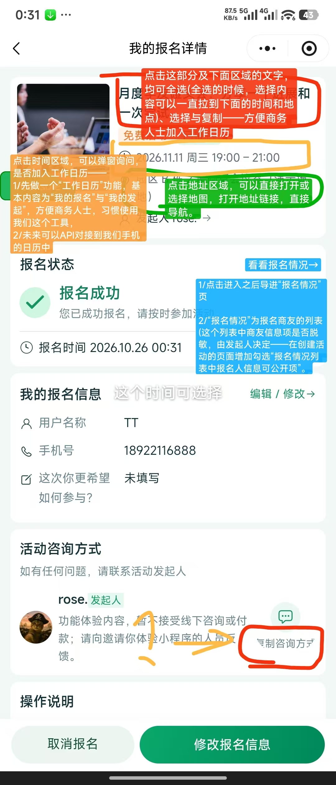
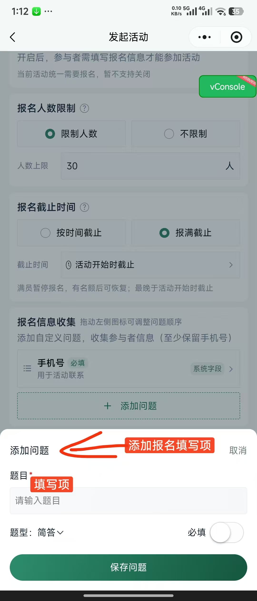
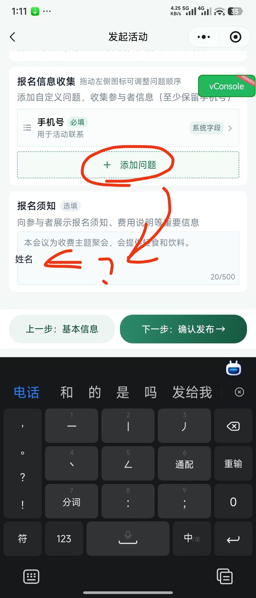
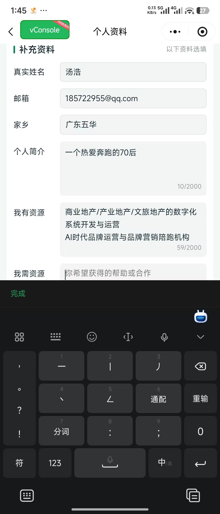
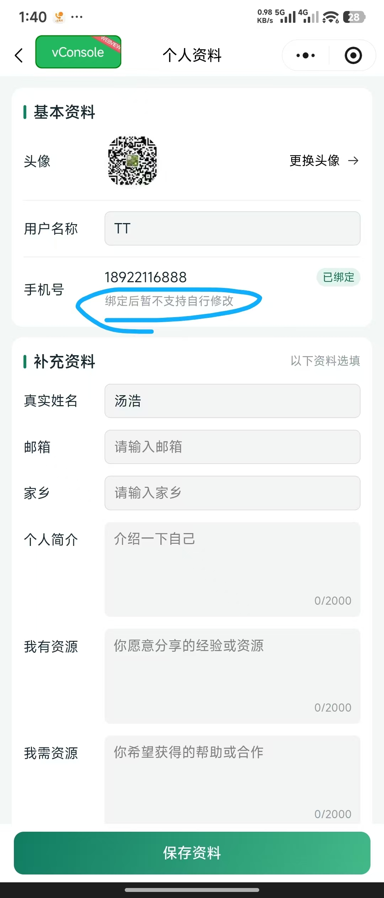
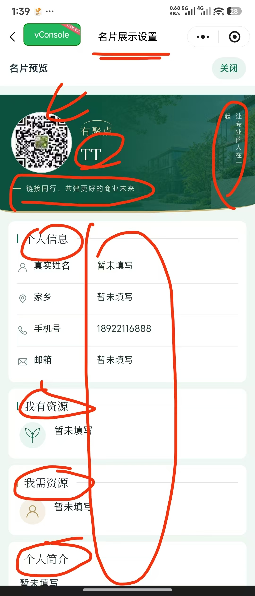
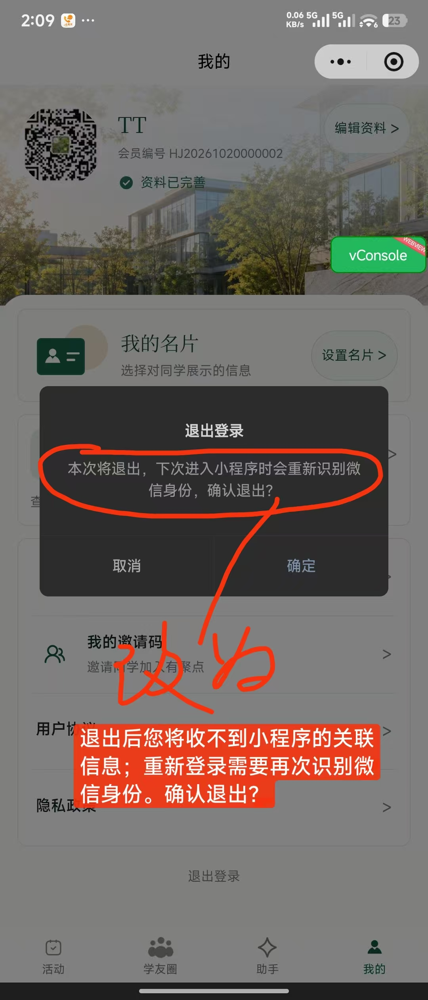
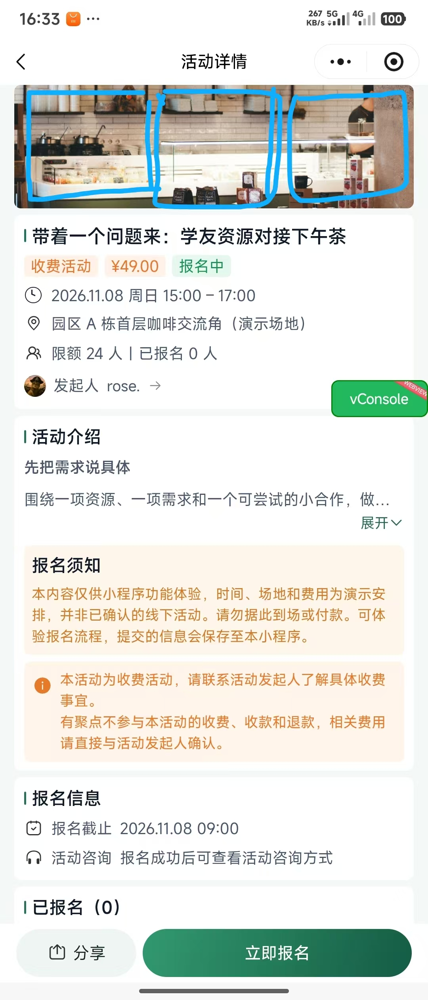

# 老板需求解决方案讨论

创建日期：2026-10-26

状态：逐项讨论中。本轮只讨论和记录，不执行解决方案。第 18 项已确认普通广告图片及介绍内容由后台管理员维护，不开放用户申请投放；轮播尺寸及部分跳转细节仍待细化。广告上传审批及智米消耗延后，本轮不做（关联第 19、26 项）。第 20 项确认先保留现有看板、查看后再定补充，暂不新增。第 21 项确认保留手动签到，扫码核销暂不做。第 22 项确认保留现有两个助手能力，不增加其他智能体场景。第 23 项确认列为后续 2.0 规划。第 24 项特邀码核心规则已记录。第 25 项方案已确认。第 26 项比例方向已确认：矮图 3:1、高图 2:1。第 27 项已确认直接一层学友关系及双向、跨分支完整人脉链路。第 28 项已确认本期预留 MCP 接入能力及默认关闭的后台开关，实际双向接通延后。本轮 28 项已逐项讨论，部分细节仍待明确。第 12、17 项暂缓，第 13、16 项不修改；小程序内工作日历及报名信息公开项配置暂不做。

原始依据：[老板需求收集](老板需求收集.md)。编号与收集稿一致，后续新增需求继续沿用编号。

## 讨论方式

- 每次讨论一项，依次提供老板原话、对应原图、建议方案及需要确定的问题。
- 原话按收集稿保留；有图片的条目直接嵌入已保存的原始图片，并附原文件链接，不用重绘图替代。没有原图的条目明确注明。
- 建议与用户确认结论分开记录；讨论修改建议时更新本项，未经确认不记为已确认。
- 简单需求简要记录，不额外展开方案或设置决策问题；需要讨论的复杂事项再提供建议。
- 本轮讨论结论仅用于记录，不启动设计生成、功能实施或验证；后续执行另按用户指示推进，不将讨论结论写成实现或验收结果。

## 本轮范围汇总（2026-10-27）

以下按各项最新讨论结论整理，供整体核对。“本期做”表示已记录的待执行方向，不表示已实施或已验收。同一项含不同子需求时可分别列入不同类别；待明确细节不自动成为新增范围。原话、原图及逐项讨论保留在下文。

### 一、本期做：已记录的待执行范围

| 原编号 | 事项 | 当前范围 |
| --- | --- | --- |
| 1 | Logo | 后续生成 2～3 个方案供选择；未预定设计方向及配色。 |
| 2、3、4 | 我的报名详情 | 有用文字支持微信长按选择复制；点击活动时间询问添加手机系统日历，可选提醒时间，默认提前 1 小时；点击地址进入地图导航；修复“复制咨询方式”遮挡；增加活动详情入口。 |
| 5 | 报名名单入口 | 复用现有名单展示与分页能力，不新增独立页面；有 1 人也能查看，继续展示头像、名称及名片入口。 |
| 6 | 报名填写异常 | 先复现，再修复输入、键盘、弹层及保存过程中的已证实问题。 |
| 7 | 报名填写项命名与预设 | 改为“添加报名填写项”“填写项名称”；常用项由发起人按需选取，保留自定义项，复用已有报名联系手机号。 |
| 8 | 历史填写项复用 | 仅复用本人保存过的填写项名称、题型、选项；修改副本不影响历史，不带入报名答案。 |
| 10 | 页面分享 | 公开内容分享对应内容；报名详情、管理页分享公开活动；不分享私密表单内容。补齐入口时检查身份尚未识别成功的分享情况。 |
| 11 | 个人资料键盘适配 | 当前输入区域保持在键盘上方并留空间，页面可滚动，键盘收起后恢复布局。 |
| 14 | 微信号及二维码 | 选填、分别控制公开，默认不公开；公开的微信号可复制、二维码可放大，未填不展示。 |
| 15 | 个性标注 | 选填一句宣传语或个性表达，在名片名称下方展示，独立于个人简介；支持公开控制，未填不展示。 |
| 18、26 | 首页图片与介绍内容 | 普通广告图及介绍内容由后台管理员维护。活动、助手为 3:1 矮轮播，学友圈为 2:1 高轮播，“我的”为 2:1 高背景；上传显示比例并可裁剪。介绍页跳转等未定细节见第四类。 |
| 24 | 活动免费特邀码 | 一人一码、一次使用，生成时绑定本人手机号，仅限指定活动；报名成功才消耗；报名截止、活动结束或取消后失效；取消报名不恢复原码，再次特邀需重新发码。 |
| 25 | 活动详情图片 | 最多 3 张，逐张横向滑动；首张封面强制 5:4 裁剪；第二、三张不强制裁剪，在 5:4 区域完整显示，可留边。列表封面展示比例不限为 5:4。 |
| 27 | 我的学友与人脉链路 | 我的学友显示直接邀请人及直接受邀人；人脉链路支持多层、双向、跨分支查看，展示完整连接路径，不改变邀请关系。 |
| 28 | MCP 预留 | 本期预留接入能力及后台开关，默认关闭；双方互通遵循同类数据与相当访问权限对等原则。 |

### 二、后续做：本轮暂缓

| 原编号 | 延后事项 |
| --- | --- |
| 3 | 小程序内工作日历；不影响本期手机系统日历入口。 |
| 5 | 发起人配置报名名单公开字段。 |
| 12 | 名片设置与预览页点击区域直接编辑。 |
| 17 | 增加品牌露出、后台调整品牌名称和显示。 |
| 19、26 | 广告上传审批、用户申请投放及智米消耗、计费扣除。 |
| 21 | 扫码核销；本期继续手动签到。 |
| 23 | 2.0 店友圈、产品与商城分享、贡献值及智米分配。 |
| 28 | 与学加实际双向接通；待接口、数据范围和授权方式明确后再做。 |

### 三、保持现状：不新增或不修改

| 原编号 | 保留内容 |
| --- | --- |
| 9、10、27 | 现有基础身份、首次有效邀请来源及邀请关系，不重建邀请机制或另建 uni code；新增展示和分享检查不改变该规则。 |
| 13 | 绑定手机号不支持自行修改，不新增换号入口。 |
| 16 | 保持现有退出确认文案，不增加“退出后收不到关联信息”的说法。 |
| 20 | 保留现有运营看板和会员活跃页面，查看实际页面后再决定增量，当前不新增。 |
| 21 | 保留手动签到。支付仍按首期规则仅展示费用，不新增平台收付款或退款状态；本轮未单独确认新的支付方案。 |
| 22 | 保留“帮我发活动”“帮我找活动”两个助手，不增加其他智能体场景。 |

### 四、待明确：不把建议当作已确认规则

| 关联项 | 尚需明确或核验的内容 |
| --- | --- |
| 1 | Logo 方案产出后的选择。 |
| 2～4 | 日历提醒可选时间、活动详情入口位置；跨区域文字选择、日历授权与兼容、地点坐标及导航须实施时验证。 |
| 5 | 0 人时的入口和空态、复用现有名单的具体跳转定位。 |
| 6、11 | 实际问题原因与设备效果，不能将反馈直接写成已复现或已修复。 |
| 7、8 | 预设项必填规则、与个人资料的关系；历史项保存触发、去重和排序。 |
| 10 | 分享页面清单、身份未识别成功时的具体交互。 |
| 15 | 个性标注字数限制和默认公开状态。 |
| 18、26 | 介绍页内容与跳转细节、“我的”背景是否可点击、广告数量与显示管理、后台管理角色细分；已记录的高矮比例需结合页面效果核对。首页广告原文“不限数量”不等同于活动详情图片上限。 |
| 20 | 查看现有看板后是否有明确的新增指标需求。 |
| 24 | “非会员”的业务含义、发放权限细分、说明文案及活动下架后恢复上架时未使用码的处理；不默认绕过当前会员操作门槛。 |
| 27 | 入口及展示形式、展开与分页、无连接路径时如何展示；完整路径规则不因界面实现被擅自截断。 |
| 28 | 接入预留的具体技术边界；后续真实接通所需的数据清单、读写权限、身份授权与对方接口能力。 |

以上汇总覆盖原编号 1～28。当前只完成文档整理，未新增功能、变更业务数据或开展功能验收。下一步建议先核对本期范围，再集中讨论影响页面及业务规则的待明确项。

## 第 1 项：重新设计有聚点 Logo

### 老板原话

> 1/有聚点那个logo不匹配我们，如我们的智能体方向的创新与引领等。
> 请再重新按照这个新的名字，让AI帮忙设计两三个，我们做个选择[抱拳][抱拳]

### 老板原图

本项未提供原图。

### 我的建议

按老板要求，后续用 AI 生成两三个 Logo 供老板选择即可，本轮先记下。

### 讨论结论

用户明确：本次只讨论，不解决。这是生成一些 Logo 供老板选择的简单需求，先记录即可。

状态：已讨论记录，待执行；不预定设计方向、配色或制作流程。本轮未生成设计图或替换资源。

## 第 2 项：我的报名详情页文字选择与复制（关联本页五项调整）

### 老板原话

> 点击这部分及下面区域的文字，均可全选(全选的时候，选择内容可以一直拉到下面的时间和地点)、选择与复制——方便商务人士加入工作日历

### 老板原图

用户于 2026-10-27 明确本图为“我的报名详情页”。红色批注对应文字选择复制，其余区域结合下方五项调整讨论。

[查看原始文件](../资源/原始图片/老板需求/codex-clipboard-ac11c185-9157-4edb-8594-0d64d0f6cada.jpg)

### 用户澄清原文（2026-10-27）

> 这个是我的报名详情页：
> 1、该页面有用的信息可以复制粘贴（这个采用微信的长按选择复制就可以了）
> 2、点击活动时间，提醒用户，是否加入系统的日历提醒（这个查一下能不能实现）
> 3、点击地址，可以跳转到地图导航
> 4、活动咨询方式部分：复制咨询方式有些字体被挡住了
> 5、这个页面最好加一个可以跳转到活动详情的入口

### 本页方案记录

1. 文字复制：按用户明确方向，页面有用的信息采用微信长按选择复制；撤下此前新增“复制活动信息”按钮的建议。保留已有咨询方式复制操作，具体可选择文本与跨区域选择效果留到实施验收。
2. 系统日历：点击活动时间，先询问是否加入手机系统日历，用户确认并完成所需授权后再添加。建议写入活动标题、起止时间和地点；用户已明确添加时可选择提醒时间，默认提前 1 小时，具体选项尚未细化。关联第 3 项，但本页系统日历入口不等同于小程序内“工作日历”功能，第 3 项原文仍保留，范围另行讨论。
3. 地图导航：点击地址打开活动地点的地图入口，再由用户选择导航；需有准确的地点坐标，具体权限和真机行为在实施时核验。
4. 咨询方式遮挡：已记录“复制咨询方式”文字被挡住的反馈，后续检查按钮空间、文字换行及窄屏适配。当前源码存在该按钮，尚未复现遮挡或确认原因，不写作已修复。
5. 活动详情入口：建议在活动摘要区域增加明确的“查看活动详情”入口，跳转至对应活动；具体摆放待确认。

### 系统日历可行性查询（2026-10-27）

- 已核对微信官方 `wechat-miniprogram/api-typings`：`wx.addPhoneCalendar` 用于向系统日历添加事件，基础库要求 2.15.0；参数包含标题、开始／结束时间、地点、事件说明、是否提醒及提醒提前量（秒）。授权设置中有 `scope.addPhoneCalendar`。
- 结论：具备实现本页系统日历提醒入口的官方接口基础；需要用户授权及运行时兼容处理。尚未验证本项目账号、iOS／Android 真机添加及实际提醒效果，不承诺所有设备均可用。
- 微信官方文档页面本次抓取失败，证据来自微信官方类型仓库，而非第三方转载：[官方 API 类型定义](https://github.com/wechat-miniprogram/api-typings/blob/master/types/wx/lib.wx.api.d.ts)；[日历接口文档入口](https://developers.weixin.qq.com/miniprogram/dev/api/device/calendar/wx.addPhoneCalendar.html)。
- 同一官方类型仓库确认 `wx.openLocation` 可用微信内置地图查看位置，作为地址入口的候选实现；导航全过程尚未验收。

### 讨论结论

页面已明确为“我的报名详情页”；文字复制采用微信长按选择复制。其余四项按上述用户要求记录，日历已完成官方接口层面的可行性查询。2026-10-27 用户确认：“让用户添加时选择提醒时间，默认提前1小时。先记录下来，我们继续讨论下一项。”活动详情入口摆放仍为建议。本轮仅更新讨论记录，未修改代码、添加真实日历事件或开展真机验收。

## 第 3 项：小程序内工作日历与系统日历入口

### 老板原话

> 点击时间区域，可以弹窗询问，是否加入工作日历——
> 1/先做一个“工作日历”功能，基本内容为“我的报名”与“我的发起”，方便商务人士，习惯使用我们这个工具，
> 2/未来可以API对接到我们手机的日历中

### 老板原图

对应黄色时间区域及橙色批注；本图为“我的报名详情页”。

[查看原始文件](../资源/原始图片/老板需求/codex-clipboard-ac11c185-9157-4edb-8594-0d64d0f6cada.jpg)

### 已明确部分

本页点击活动时间，询问是否添加手机系统日历；添加时由用户选择提醒时间，默认提前 1 小时。接口可行性与未验证边界见第 2 项。

### 我的建议（待讨论）

小程序内“工作日历”可在“我的”页设置入口，按日期汇总“我的报名”和“我的发起”，便于统一查看活动安排。作为产品建议，有效报名和已发布的本人发起活动自动出现在该视图，不要求逐场手动添加；同一活动不重复展示。具体状态展示及日历布局待范围确定后讨论。

### 讨论结论

2026-10-27 用户原话：“小程序内的工作日历也保留就不做了暂时。”按保留需求、暂不实施记录；手机系统日历提醒继续保留已明确方案。上方小程序内入口位置、自动汇总及去重仍是建议，暂不展开或实施。

## 第 4 项：地址区域操作

老板原话及原图见需求收集稿第 4 项，同一张“我的报名详情页”原图已展示于上方。用户在本页五项调整中明确：“点击地址，可以跳转到地图导航”。方案方向已记录，后续实施需核对地点坐标及实际导航效果，本轮不重复讨论或实施。

## 第 5 项：报名情况列表与信息公开项

### 老板原话

> 1/点击进入之后导进“报名情况”页
>
> 2/“报名情况”为报名商友的列表(这个列表中商友信息项是否脱敏，由发起人决定——在创建活动的页面增加勾选“报名情况列表中报名人信息可公开项”。

### 老板原图

对应“看看报名情况→”入口及蓝色批注。

[查看原始文件](../资源/原始图片/老板需求/codex-clipboard-ac11c185-9157-4edb-8594-0d64d0f6cada.jpg)

### 我的建议（待讨论）

名单入口按下方用户最新确认方向复用现有展示。此前提出的发起人勾选公开字段及与报名人授权衔接的建议，本轮暂不推进；以用户最新结论为准，保持头像和名称展示。

### 当前实现核对（2026-10-27，只读源码）

- 活动详情页已实现“已报名”和“阅读留痕”两个内嵌列表，均展示头像和名称，默认最多展示前 8 人；符合数量条件时显示“查看全部”，点击在当前页展开，并有分页追加及失败处理。点击人员进入名片流程。
- 已报名接入 `api.roster`，后端读取有效报名记录；阅读留痕接入 `api.activityReaders`，后端已有阅读记录查询。因此不能将本需求描述为从零补做这两类列表。
- 当前“查看全部”是在活动详情页展开，并非跳转独立的报名／阅读人员列表页。报名详情页尚无“看看报名情况”入口；其“返回活动详情”按钮目前只在报名状态不是 active 时显示。
- 本轮尚未验证微信开发者工具中的实际显示和接口运行，不将源码存在等同于当前页面运行验收通过。
- 上述为修改前的源码现状；后续方向以下方用户确认记录为准，复用已有名单接口，不重复建设取数能力。

### 用户确认：名单入口与页面（2026-10-27）

> 1、不要人数较多时可“查看全部”。哪怕只有一个人也可以查看。
> 2、复用已有名单能力，也就是跳转到报名列表页

- 报名名单入口不再以人数较多或超过 8 人作为显示条件；有 1 人也可以点击查看。0 人时的入口及空态尚未明确。
- 用户随后纠正：“不需要增加独立页面。直接就是用现在的报名列表页”。以此次纠正为准，撤回新增独立活动报名列表页的方案，复用现有报名名单展示和接口、分页能力。
- 按当前源码，普通用户可看的现有名单位于活动详情“已报名”区域；“我的报名详情”的报名情况入口复用此处。具体跳转定位方式留待实施，不把发起人专用管理名单开放给普通用户。
- 此处指某场活动的报名人员名单，不是“我的报名”活动记录列表。阅读留痕不因本次讨论增加独立页面。
- 当前仅记录方案，尚未新增页面或修改代码。

### 讨论结论

报名名单复用现有展示，不新增独立页面，有 1 人也可查看；此前“跳转独立报名列表页”的记录已撤回。2026-10-27 用户明确：“公开项配置暂时不做，先保持现有的头像和名称展示。记录下来，我们继续讨论下一项。”因此本轮不增加发起人公开字段配置，保持现有头像、名称及点击查看名片能力，不改变个人资料可见规则。第 5 项讨论告一段落，仅记录、未实施。

## 第 6 项：“添加问题”填写异常，需测试

### 老板原话

> 这个BUG的意思是，
>
> 1/“添加问题”功能失效，请测试一下。
> 目前看到的问题是填写不了，填写的区域和下面搞混了。

### 老板原图

[查看原图 1](../资源/原始图片/老板需求/codex-clipboard-65fc882b-34ba-4df7-a0b4-96c1b09cc18a.jpg)

[查看原图 2](../资源/原始图片/老板需求/codex-clipboard-cc1de282-53a8-4412-8d94-86d9d84c1f44.jpg)

### 我的建议（待讨论）

作为现有功能缺陷处理。后续实施时先复现“添加问题”的输入、键盘弹出与收起、滚动及保存过程，重点核对输入焦点、弹层与下方报名须知区域是否互相干扰，再针对已证实的原因修复。验收目标为题目和选项能正常填写、保存后正确显示，操作不会误入下方区域；开发者工具和真机分别验证。

本项先恢复正常填写，不与第 7 项命名及系统默认项、第 8 项历史填写项复用合并扩大范围。当前是用户反馈，尚未复现或确认原因。

### 讨论结论

2026-10-27 用户确认按“待复现修复”处理：后续先复现，再针对已确认原因修复，确保填写与保存正常、不误操作下方区域。本轮仅确认方案，未操作表单、写入业务数据或修改代码。

## 第 7 项：明确报名填写项含义，增加系统默认项

### 老板原话

> 2/这个添加问题应该是指添加报名填写项？所以——
> A.应该预设多几个报名一般要填写的“系统默认项”，如：
> 手机
> 姓名或昵称
> 性别
> 公司或组织
> ……

### 老板原图

原图将“添加问题”标注为“添加报名填写项”，将“题目”标注为“填写项”。

[查看原始文件](../资源/原始图片/老板需求/codex-clipboard-65fc882b-34ba-4df7-a0b4-96c1b09cc18a.jpg)

### 我的建议（待讨论）

- 命名采用“添加报名填写项”，编辑中的“题目”改为“填写项名称”。
- 提供手机、姓名或昵称、性别、公司或组织等常用项供发起人快捷选择，同时保留自定义填写项。
- 建议将“系统默认项”理解为可选预设，不自动要求每场活动收集全部字段；已存在的报名联系手机号应复用，避免重复添加。
- 常用项不自动全部加入，由发起人按需点选（已确认）；必填规则及与个人资料的关系尚待细化，本轮不推定报名内容自动修改会员资料。

### 讨论结论

2026-10-27 用户确认上述方案：“添加问题”改为“添加报名填写项”，“题目”改为“填写项名称”；手机、姓名或昵称、性别、公司或组织等常用项作为按需点选的预设，不自动全部加入每场活动；保留自定义项，已有报名联系手机号直接复用，避免重复填写。本轮仅记录，尚未实施。

## 第 8 项：创建过的报名填写项支持记忆与下拉复用

### 老板原话

> B.创建之后，创建项目都有记忆，在填写栏点击之后，下拉可以看到之前的记忆项，方便创建者快速填写。

### 老板原图

沿用第 6～8 项同批次的添加问题弹层参考图，本项没有单独提供的新图。

[查看原始文件](../资源/原始图片/老板需求/codex-clipboard-65fc882b-34ba-4df7-a0b4-96c1b09cc18a.jpg)

### 我的建议（待讨论）

- 仅记忆当前账号自己创建并保存过的报名填写项，跨活动复用。
- 点击“填写项名称”时，下拉展示历史项；选择后带入名称、题型及选项，并允许针对当前活动修改。
- 复用的是填写项配置，不包含报名人的答案；修改当前活动中的副本不反向修改历史活动。
- 保存触发时机、去重及排序等细节待需要时细化，不自动扩展为公共模板库。

### 讨论结论

2026-10-27 用户确认个人历史填写项复用：记忆当前账号自己创建并保存过的填写项；点击填写项名称下拉选择，带入名称、题型和选项；允许修改当前活动中的副本，不影响历史活动，不带入报名人的答案。保存触发、去重及排序等细节留待后续细化。本轮仅记录，尚未实施。

## 第 9 项：所有分享携带邀请来源，建立上下关系链路

### 老板原话

> 分享的功能要细化（目前好像主要是有分享键的才能分享）：
> 1/所有的分享都要带邀请码那种，要建立起他们的上下关系链接。包括未注册的人也可以分享，但是这种关系链接就用他们的 uni code？

### 老板原图

本项未提供原图。

### 现有正式规则

按首期 PRD，进入小程序先静默建立或恢复基础身份；手机号、主动头像及名称未完善者仍是游客。邀请码随基础身份存在，不必等到资料完善才有邀请来源。首次有效邀请关系建立后保持不变，后续分享不覆盖；静默识别失败不当作已取得新身份。

### 我的建议（待讨论）

- 可分享页面统一携带分享者已有邀请码；尚未完善资料、但已经静默识别的游客也使用自己的邀请码，无需另建“uni code”标识体系。
- 新用户通过分享进入时，沿用首次有效来源规则建立邀请关系；已有上级的用户不因再次访问而更换上级。
- 若分享者尚未取得基础身份或静默识别失败，不伪造邀请码；这类分享能否暂不带邀请归属或需先识别成功，仍待明确。
- 第 10 项再逐页讨论右上角分享入口及适用页面范围。本轮未逐页验收当前分享实现。

### 讨论结论

2026-10-27 用户明确：“我们现在的邀请制关系其实就是这样子。所以这个不用”。第 9 项按现有邀请机制已覆盖、无需新增或重做记录，不另建“uni code”体系，也不据此扩展身份识别失败等改造任务。本轮未进行真实微信分享链路验收。

## 第 10 项：页面右上角三点菜单支持分享，统一邀请链路

### 老板原话

> 2/许多页面的右上角那三个点，需要都可以用来做分享，分享的底层逻辑也是按上面1/所述，带邀请码与上下关系链路的。

### 老板原图

本项未提供原图。

### 我的建议（待讨论）

沿用现有邀请逻辑，本项只核对并补齐适合对外分享的页面入口。公开内容页可分享当前内容；个人报名、编辑表单及管理页面不直接分享私人内容，可按需隐藏入口或转为分享对应公开活动。具体页面范围先核对现有实现再确定，不将“许多页面”直接等同所有页面。

### 讨论结论

2026-10-27 用户确认分享原则：公开内容页分享当前页面或内容；我的报名详情、活动管理页分享对应公开活动详情；资料编辑、报名表等不分享表单内容。沿用现有邀请机制，具体页面清单后续核对。复核后用户再次确认：补齐分享入口时，一并检查“身份尚未识别成功就分享”的情况，邀请关系规则保持现状。该确认纳入检查范围，尚未确定识别失败时的具体分享交互。本轮不修改分享代码或执行微信分享。

### 现有邀请与登录逻辑复核（2026-10-27）

证据：`apps/miniapp/src/App.vue`、`stores/session.ts`、`services/wechat/index.ts`、`services/api/index.ts`、`services/navigation.ts`、`pages/login/index.vue`、`pages/mine/index.vue`；服务端 `apps/api/src/flow/identity.ts`、`wechat.ts`、`member-number.ts` 及身份表唯一约束。均为本轮只读源码核对，未调用身份或业务接口、未写库，未重跑测试或进行真实微信验收。

- 进入／返回小程序时捕获入口邀请码并启动身份恢复。已有 token 先向服务端刷新本人资料；无 token 或遇到身份失效时通过微信 code 识别，网络失败不直接视为新账号。
- 服务端交换微信 code 后按 AppID＋OpenID 查找已有账号；UnionID 可保存，但不是当前账号匹配或跨产品合并依据。
- 新微信身份首次创建基础账号时，在事务中分配会员编号与邀请码并绑定邀请上级；有效邀请码对应普通账号（含资料未完善游客）时绑定该账号，无邀请码或无效邀请码归平台根。已有微信身份恢复原账号，不重写上级。唯一约束及并发冲突回读避免重复建身份和改写邀请。
- 前端本次运行首次入口来源被锁定，识别中或已有 token 时不再替换；服务端以首次创建时写入的上级为准。直接进入并成功建号后，之后再点他人分享也不会补改上级。
- 游客已可拥有基础身份、编号、邀请码和会话；只有绑定手机号、主动设置头像、主动设置用户名称三项完整，才判为资料完整会员。默认头像／名称不替代主动设置；真实姓名不是此门槛。
- 公开浏览不强制完善资料；报名、发起等受限操作由前端引导完善，服务端也校验完整度。完善后返回原业务上下文。静默识别不自动记录协议同意，协议确认另行处理。
- 会话缓存按 API 环境隔离；过期或 401 会清理失效会话，重新识别仍恢复同一微信账号。退出撤销当前会话并清理本地状态，不删除资料或邀请关系；后续进入／触发身份恢复会再次静默识别。
- 会员编号格式为 HJ＋北京时间日期＋六位序号；对外邀请码为 HJYQM＋日期＋六位序号，后端兼容历史邀请码。
- 边界：现有活动／帖子分享在取得邀请码时才拼入邀请来源；识别未完成或失败时可能分享无邀请码链接，接收方首次建号会归平台根。这不等同于已经保证“所有分享必带邀请码”，后续补齐分享入口时应纳入检查，当前不擅自改动。

## 第 11 项：键盘弹出后填写页面上移，增加下方可见空间

### 老板原话

> 当键盘浮上来之后，填写的底页应该再往上拉一些，即，留出更多的空间看到下面。

### 老板原图

对应“个人资料”页填写“我需资源”时键盘弹出的场景。

[查看原始文件](../资源/原始图片/老板需求/codex-clipboard-e828e060-f625-4bce-bdb2-aec5e7e8c92b.jpg)

### 我的建议（待讨论）

以个人资料页为本项范围，输入框获得焦点、键盘弹出时，让当前输入区域上移并在键盘上方留出可见空隙，仍能滚动查看后续内容。键盘收起后恢复正常布局，避免页面跳动或留下过大空白。具体间距依据实际设备效果调整，不先固定整页上移量。

后续实施时核对长文本、多行输入、输入框切换和键盘收起场景，并分别检查开发者工具、iOS／Android 真机效果。当前仅记录反馈，尚未复现或确认原因。

### 讨论结论

2026-10-27 用户确认：个人资料页键盘弹出时，当前输入区域上移并在键盘上方留出可见空间，页面仍可滚动；键盘收起后恢复正常布局。具体间距以手机实际效果调整。本项记为待优化，本轮未修改代码或开展交互验收。

## 第 12 项：名片展示设置与预览页支持点击对应区域编辑

### 老板原话

> 名片展示设置与名片预览页，都应该有编辑的功能。也就是点击那个区域可以修改。
>
> 因为在预览页看着区域修改内容，即视感是最强的。[握手][抱拳]

### 老板原图

图中圈画或箭头涉及头像、名称、顶部横向文案、右侧竖向文案、个人信息、我有资源、我需资源和个人简介等区域；标注不直接代表所有内容均已获准编辑。

[查看原始文件](../资源/原始图片/老板需求/codex-clipboard-43f00879-a2a5-4718-8c2d-2245b57b0c24.jpg)

### 我的建议（待讨论）

在本人名片展示设置和本人预览页，点击可编辑的个人信息区域，打开该字段的小型编辑面板；保存后刷新名片预览，取消则保留原内容。沿用现有个人资料字段及可见性设置，查看他人名片不出现编辑入口。

先讨论点击区域就地编辑的交互方向。头像沿用现有选择流程；手机号修改关联第 13 项另行讨论，平台固定文案的编辑范围不依据圈画自动放开；微信信息及个性标注关联第 14、15 项。

### 讨论结论

2026-10-27 用户明确：“这个先不管了”。第 12 项暂缓，保留原始需求；上方点击区域编辑方案未获确认，当前不继续细化或实施。本轮未修改代码或开展交互验收。

## 第 13 项：允许修改用户手机号，评估底层设定调整

### 老板原话

> 用户的手机号应允许修改。要看看底层的设定要做哪些优化？

### 老板原图

个人资料页手机号区域圈出“绑定后暂不支持自行修改”的提示。

[查看原始文件](../资源/原始图片/老板需求/codex-clipboard-928dcb94-247d-46d6-ae27-2376b6eeb305.jpg)

### 已核对的现状

本轮此前源码复核确认：账号身份以 AppID＋OpenID 匹配，手机号是绑定资料；`IdentityService.phone` 当前拒绝重复绑定，返回 `PHONE_ALREADY_BOUND`。现行首期 PRD 不包含会员自行修改已绑定手机号，因此本项属于拟调整的产品规则，尚未实施。

### 我的建议（待讨论）

在个人资料页提供“更换手机号”，沿用微信手机号授权获取并校验新号码，成功后更新当前账号的绑定手机号。保持同一账号、会员编号、邀请码及邀请关系，不因换号创建或合并账号。建议历史报名中单独填写的联系手机号保留原记录，不随个人绑定手机号自动改写。

### 讨论结论

2026-10-27 用户明确：“修改手机号这个也不做。不要修改手机号”。第 13 项不做，保持现有绑定后不可修改手机号的规则；上方“微信重新授权更换手机号”建议不采用，不新增换号入口或继续细化换号方案。保留老板原话供追溯。本轮未修改正式规则、代码或手机号数据。

## 第 14 项：名片页与个人信息页增加微信号、微信二维码及公开设置

### 老板原话

> 这个名片页与个人信息页，缺了两项：
> 1/允许用户放置：
> 微信号和微信二维码图，也是让用户可以勾选是否对外。

### 老板原图

本图为第 14～15 项同批次的名片展示设置与字段补充参考图。

[查看原始文件](../资源/原始图片/老板需求/codex-clipboard-7228cfe8-95b1-4eb7-9466-4d940074a3af.jpg)

### 我的建议（待讨论）

个人资料页增加选填的微信号及微信二维码图片上传；名片展示设置中分别控制二者是否对外展示，建议默认不公开，由本人主动勾选。名片按设置展示，微信号可复制，二维码可点击放大查看。未填写则不占展示位置，不作为会员资料完整度门槛。

本项是资料字段及可见性扩展，不自动恢复第 12 项已暂缓的名片区域直接编辑，也不调整第 13 项手机号规则。

### 讨论结论

2026-10-27 用户确认：个人资料可选填微信号、上传微信二维码，两项分别设置是否公开，默认不公开；公开后名片上的微信号可复制、二维码可点击放大，未填写则不展示。本轮仅记录，尚未实施。

## 第 15 项：增加“个性标注”字段，支持用户自主宣传

### 老板原话

> 2/增加一字段：
> “个性标注”（你想说的个性话语）
>
> 即，这个字段是一个备注栏，也是让用户有宣传自主权。

### 老板原图

沿用第 14～15 项同批次参考图。

[查看原始文件](../资源/原始图片/老板需求/codex-clipboard-7228cfe8-95b1-4eb7-9466-4d940074a3af.jpg)

### 我的建议（待讨论）

个人资料增加选填的“个性标注”文本，提示语采用“你想说的个性话语”；用于简短宣传语或个性表达，与现有个人简介分开。建议在名片名称下方展示，未填写不显示，沿用名片设置提供是否公开的控制。具体字数限制及展示位置待确认，不预设为长篇介绍或替换平台固定文案。

### 讨论结论

2026-10-27 用户确认：个人资料增加选填“个性标注”，用于一句宣传语或个性表达，与个人简介分开；在名片名称下方展示，未填写不展示，并允许设置是否公开。具体字数及默认公开状态尚未确定。本轮仅记录，尚未实施。

## 第 16 项：调整退出登录确认文案

### 老板原话（拟替换文案）

> 退出后您将收不到小程序的关联信息；重新登录需要再次识别微信身份。确认退出？

### 老板原图

[查看原始文件](../资源/原始图片/老板需求/codex-clipboard-4f6da464-7a09-4d15-b8f6-8501321c1ded.jpg)

### 当前实现与建议（待讨论）

本轮只读核对 `apps/miniapp/src/pages/mine/index.vue`，当前文案为：“本次将退出，下次进入小程序时会重新识别微信身份，确认退出？”退出流程撤销当前会话并清理本地身份；本轮未发现该动作关闭消息接收的依据，因此不建议采用“退出后您将收不到小程序的关联信息”的绝对表述。

建议保持当前文案，准确说明退出及重新进入时的身份识别行为。老板原话保留，消息接收机制不由文案讨论推定或改动。

### 讨论结论

2026-10-27 用户确认保持当前退出提示：“本次将退出，下次进入小程序时会重新识别微信身份，确认退出？”不采用“退出后收不到小程序的关联信息”的表述。第 16 项不修改，本轮未修改文案或执行退出操作。

## 第 17 项：增加品牌展示，支持按需在后台调整名称与显示

### 老板原话

> 另有，几个优化建议：
>
> 1/要多显示“有聚点”（如果是卖软件，这个名字与显示可以按需在后台改变）

### 老板原图

本项未提供原图。

### 我的建议（待讨论）

将需求分为当前产品的品牌露出、后续售卖软件时的品牌配置两部分。当前先确定需要展示品牌的位置，例如首页顶部或“我的”页；不在每个内容区重复堆叠名称。后台品牌配置建议后续单独明确范围，不能将应用内展示名称配置等同于微信平台登记名称变更，也不据此预设多租户或白标架构。

### 讨论结论

2026-10-27 用户明确：“这个也先不管”。第 17 项整体暂缓，保留原始需求；本轮不继续细化品牌展示位置或后台名称配置，不实施相关调整。

## 第 18 项：各页广告栏改为轮播，支持进入企业详情介绍页

### 老板原话

> 2/每一页上面的广告栏应该改为轮播栏，点击可以进入看到被宣传企业的详情与介绍页

### 老板原图

本项未提供原图。第 25 项图片针对活动详情关联图片，不作为本项首页广告栏的设计稿。

### 关联补充

第 26 项已收录的原始要求进一步明确：活动页矮轮播、学友圈高轮播、助手页矮轮播，“我的”页高背景图；上传可裁剪并显示尺寸比例，点击图片进入项目／公司介绍页，包含企业名称、联系人、联系方式、介绍详情图等。广告图片不限数量，另有智米消耗申请要求。上述为收录需求，具体方案尚未确认。

### 我的建议（待讨论）

先明确展示及跳转：三个首页的广告图片点击进入对应项目／公司的统一介绍页，内容为企业／项目名称、联系人、联系方式及介绍图文；“我的”页按后续补充保留高背景图，不自动改为轮播。广告上传审批与智米消耗规则分别关联第 19、26 项，暂不混入本项的页面方案确认。

### 讨论结论

2026-10-27 用户明确：“上传审批、智米消耗分别放到后续再做。不要现在做”。广告上传审批与智米消耗移至后续阶段，本轮不做，分别关联第 19 项及第 26 项相关内容。随后用户确认普通广告图片及介绍内容先由后台管理员维护，不开放用户申请投放。该确认不代表具体尺寸、后台角色细分及“我的”页背景图跳转等细节已确定。本轮仅讨论，尚未实施。

## 第 19 项：广告运营“后台前端化”，运营管理员可在前端审批上传广告图

### 老板原话

> 3/每页的广告栏“后台前端化”——被设置为运营管理员的用户，可以在前端审批上传广告图。

### 讨论结论

2026-10-27 用户明确广告上传审批延后，本轮不做；本项审批上传流程暂不细化或实施，保留原始需求。普通广告图片及介绍内容由后台管理员维护、不开放用户申请投放的方案已在第 18 项确认。

### 第 26 项相关范围备注

第 26 项中的智米消耗、计费及扣除暂放后续，不在本轮做。第 26 项其他内容（图片布局、裁剪、尺寸比例及介绍页）不因该决定自动取消或视为已确认，仍按各自讨论状态处理。

## 第 20 项：后台增加多功能可视化看板

### 老板原话

> 4/“有聚点”的后台尽可能要有多功能可视化看板。

### 老板原图

本项未提供原图。

### 当前实现核对（2026-10-27，只读源码）

- 后台已有 `/analytics` 运营看板及 `/engagement` 会员活跃页面。
- `AnalyticsPage.vue` 已有会员及活动运营指标、每日新增／浏览活跃／参与活跃趋势图、参与行为分布及每日数据表。
- `EngagementPage.vue` 已有会员行为次数、最近活跃、筛选、会员行为明细及导出入口。
- 本轮仅核对路由及页面源码，未登录后台或验证实际数据、图表和导出效果；页面存在不等同于本轮运行验收通过。

### 我的建议（待讨论）

先以已有运营看板和会员活跃页面作为本项基础，后续查看实际页面后再明确需要补充的指标或图表；不将笼统的“尽可能多功能”直接扩展为新增一套看板。本轮可先记为“已有基础，待查看现有页面后明确增量”。

### 讨论结论

2026-10-27 用户确认：保留现有看板基础，先记为“已有基础，查看现有页面后再确定补充内容”，暂不新增功能。本轮仅记录，未登录验收实际页面或修改代码。

## 第 21 项：活动核销扫码与支付版块待测试、待讨论

### 老板原话

> 5/活动核销扫码与支付版块未测，明天讨论。

### 老板原图

本项未提供原图。“未测”保留为需求提供方的表述，不代表相关功能均已实现。

### 当前范围与建议（待讨论）

首期 PRD 明确支持发起人手动标记到场；当前活动管理页已有相关操作。扫码核销应单独核对业务流程，不能以通用扫码工具函数存在视为已经实现。建议先明确是否需要新增扫码签到，若需要，再讨论由发起人扫报名者的码，还是报名者扫活动码。

支付方面，首期正式规则只展示固定费用，由用户联系发起人处理，不包含平台内支付或付款退款状态。建议支付继续保持现状，本轮不把原文“未测”理解为已有支付能力或新增支付授权。

### 讨论结论

2026-10-27 用户明确：“先保留现有手动签到”。签到继续使用现有手动标记到场，扫码核销暂不纳入本轮。支付未获新增授权，仍按现行首期规则仅展示费用、不实现付款退款，未将用户对签到的确认扩写为支付方案确认。本轮未进行签到、扫码或支付测试，未修改代码或业务数据。

## 第 22 项：商议 AI 与智能体的启用方式

### 老板原话

> 6/AI与智能体需商议如何启用

### 老板原图

本项未提供原图。

### 当前实现与建议（待讨论）

小程序助手页源码已有“帮我发活动”和“帮我找活动”入口，分别进入活动草拟及活动搜索页面。本轮仅核对页面入口，不代表模型服务已配置、实际调用可用或真实推荐效果已验收。

建议先围绕这两个现有能力明确使用方式：AI 辅助整理活动草稿，用户检查后自行发布；AI 根据用户需求帮助找活动。暂不扩展为通用聊天或自动执行业务操作的智能体。是否需要后台开关、使用权限或其他场景，待本项方向明确后讨论。

### 讨论结论

2026-10-27 用户明确：“可以，先保留现有的两个助手能力，不增加其他智能体场景。记录下来，我们继续下一项。”本轮保留“帮我发活动”“帮我找活动”，不增加其他智能体场景。本次仅记录，不据此新增助手优化任务，未调用模型或修改配置。

## 第 23 项：盘点此前 2.0 规划中尚未完成的功能

### 老板原话

> 7/按之前规划2.0有哪些功能未做？

### 老板原图

本项未提供原图。

### 本轮核对

正式来源为 `docs/product/版本路线图.md` 的“2.0 版本：店友圈”：以园区店为主的好品及商城分享、店主上传产品、用户分享获得贡献值及双方可视化、门店与平台权益相关的智米分配。商城交易边界、贡献值计算及智米分配记录规则仍属待设计内容，不纳入首期验收。

本轮对 `apps`、`packages` 做相关关键词检索并检查 API 模块目录，未找到上述 2.0 业务链路的明确实现证据；这是静态初步盘点，不是完整代码审计或运行验收。现有学友圈属于 1.5，不能据其存在判断 2.0 店友圈已完成。

### 我的建议（待讨论）

先将上述 2.0 项目列为后续规划、未确认完成，不并入当前需求实施范围；若需向老板提供正式完成度清单，再逐项对照页面、接口、数据和验证证据深入盘点。

### 讨论结论

2026-10-27 用户确认：上述店友圈、产品与商城分享、贡献值及智米分配列为 2.0 后续规划，暂不并入本轮实施。本轮仅完成初步静态盘点并记录，未新增业务功能或变更路线图。

## 第 24 项：付费聚会支持免费特邀码报名，并提供必要文字说明

### 老板原话

> “付费聚会”那个版块，要能实现付费聚会免费特邀码，实现在付费聚会报名时，可用特邀码实现免付费报名。
> （这个功能，是要解决拓新会员的需求：一般非会员是付费的，但对特邀的人员可实现免费参加(要注意象猩聚社这个功能，有必要的文字说明这个特邀码)）

### 老板原图

本项未提供原图。

### 我的建议（待讨论）

若本轮保留此功能，建议作为某场收费活动的免费参加资格处理：由发起人发放该活动特邀码，报名时校验，通过后在报名记录与发起人名单标注“特邀免费”。它表达发起人给予的免费资格，不引入平台收付款或退款状态。

活动特邀码与建立上下级关系的会员邀请码分开；不改变现有邀请关系，也不自动绕过手机号、主动头像和名称的会员操作门槛。原文“非会员”的具体含义仍待澄清，不直接等同于本产品资料不完整的游客。有效期、次数、发放权限及说明文案在确认本轮范围后再细化。

### 讨论结论

2026-10-27 用户明确：“这个要做”。第 24 项纳入本轮待实施范围，当前继续讨论规则。用户确认一人一码、单次使用，生成时绑定受邀人手机号、仅本人可用；仅限指定活动，报名截止后失效，报名成功才消耗、报名失败不消耗。用户补充：“是。但是活动结束或者取消，这个码也是跟着失效的”。活动结束或取消后码随之失效。取消报名后原码不恢复，需发起人重新发码；具体文案等后续细化。本轮未实现特邀码、支付或修改报名规则。

### 特邀码使用方式（已确认）

用户确认一人一个特邀码，每个码只能使用一次；生成时绑定受邀人的手机号，仅本人可用，不采用多人共用码或持码即用方式。实现口径应以当前账号经微信授权绑定的手机号与码上预绑定号码核对，不能以报名表可填写的联系手机号代替身份校验。沿用当前账号手机号不可自行修改的规则。取消报名后原码不恢复，需发起人重新发码。

### 活动范围、失效与消耗（已确认）

- 特邀码仅限生成时指定的活动，不跨活动使用。
- 报名截止、活动结束或活动取消后，特邀码失效；已使用记录保留，不因失效删除历史免费资格记录。
- 报名成功才消耗特邀码，报名失败不消耗。
- “活动取消”使活动特邀码失效；用户取消报名不恢复已用码。活动下架时仍须遵守现有禁止报名规则；恢复上架是否影响未使用码的有效性不在本次确认中推定。

### 取消报名后的处理（已确认）

2026-10-27 用户确认：成功使用特邀码报名后，即使自行取消报名，原码也不恢复可用；若需再次特邀免费报名，由发起人重新发码。本轮仅记录规则，尚未实施。

## 第 25 项：活动详情页顶部图片支持轮播、上传裁剪与尺寸标注

### 老板原话

> 建议：页眉这个长条，可以转为3张或4张，轮播图。

后续补充：

> 1/活动详情这一页轮播图为与活动关联的图，设置为上传时可以裁剪，标注尺寸比例。
>
> 2/轮播与裁剪：若用户只传一张，就将一行一张扁长图的尺寸标出；若用户传两张，就将一行两张图格局，标注每张图的尺寸；若用户传三张图及三张以上的图，就用一行三张图格局，标注每张图的尺寸。
>
> 3/活动详情轮播栏的这组轮播图，最多先限3张。

### 老板原图

[查看原始文件](../资源/原始图片/老板需求/codex-clipboard-6f1116a7-f1ad-4d77-b52e-5507cf51a30c.jpg)

### 我的建议（待讨论）

此前建议按数量并排展示；用户随后调整为横向图片形式，以下方最新记录为准，不再沿用一行多张的建议。本项最多 3 张，不套用首页广告不限数量的规则。

### 用户调整原文（2026-10-27）

> 这个改一下，还是采用横屏的形式，比例是5：4。
> 第一张为封面，强制用户进行一个 5：4的裁剪。后面的第二第三张就不用
> 但是列表的活动封面就可以不一定要显示为5：4。

### 当前确认方向

- 活动详情顶部采用横向图片形式，比例为宽:高＝5:4，替代此前一行多张的方向。
- 第一张为活动封面，上传时必须经过 5:4 裁剪。
- 第二、第三张不强制按 5:4 裁剪。
- 活动列表中的封面展示比例可按列表布局安排，不要求显示为 5:4；封面源图仍来自第一张裁剪结果。
- 最多 3 张活动关联图片的上限保持。详情顶部逐张横向滑动查看；第二、第三张完整显示在统一 5:4 区域内，比例不同时留边，不强制裁剪（用户已确认）。

### 讨论结论

2026-10-27 用户确认：详情顶部逐张横向滑动查看；第二、第三张完整显示在同一 5:4 区域内，比例不同时留边，不裁掉内容。结合此前确认，首图为封面且强制 5:4 裁剪，最多 3 张；活动列表的显示比例不限定为 5:4。第 25 项方案已记录，本轮未生成或裁剪图片、未修改代码。

## 第 26 项：四个 Tab 首页顶部图高矮规划及裁剪展示

### 老板原话

> 四个tabbar首页顶部图的尺寸参次了些，完全一样也会死板，可以一矮一高一矮一高。
>
> 2/轮播图/背景图/高矮规划：
> 活动页：轮播图，矮图
> 学友圈：轮播图，高图
> 助手页：轮播图，矮图
>
> 我的页：背景图，高图

> 3/上传这些图片时，可裁剪，并带尺寸比例显示。
>
> 4/点击每张图都可引导到一个该项目/公司的介绍详情页(含企业名称、联系人、联系方式、介绍详情图等)
>
> 5/轮播图，为广告栏，图的数量与显示需管理：
> A.不限数量
> B.基于智米消耗，用户可提交轮播申请，轮播消耗暂设为(可调)：1智米/天，

### 老板原图

本项未提供单独原图，不使用第 25 项活动详情截图代替首页方案。

### 已明确的关联范围

第 18 项已确认普通广告图片及介绍内容由后台管理员维护，不开放用户申请投放；上传审批和智米消耗延后。第 25 项的 5:4 封面规则仅针对活动详情，不自动套用到首页广告栏。

### 我的建议（待讨论）

按四页“矮／高／矮／高”的要求，建议先以宽高比 3:1 作为矮图、2:1 作为高图，供页面效果验证：活动与助手用 3:1 轮播，学友圈用 2:1 轮播，我的用 2:1 背景图。后台上传时显示对应比例并提供裁剪。比例是本次建议值，未获确认，也未经页面视觉验证。

介绍页跳转及广告数量沿用原始需求继续细化，“我的”页背景图是否作为可点击广告仍未明确；本轮不推定开放用户投放。

### 讨论结论

2026-10-27 用户确认先按上述比例记录：活动页、助手页为 3:1 矮轮播图，学友圈为 2:1 高轮播图，“我的”页为 2:1 高背景图；后台上传显示对应比例并支持裁剪。比例先作为方案方向，后续结合页面效果核对。“我的”页背景图是否跳转介绍页等细节仍待明确。本轮仅记录，尚未实施。

## 第 27 项：增加“我的学友”与人脉链路

### 老板原话

> 1、增加 我的学友 （上下级邀请人）、 人脉链路

### 老板原图

本项未提供原图。

### 我的建议（待讨论）

在“我的”页提供相关入口；点击人员进入现有名片，继续按现有资料可见规则展示，不修改已建立的邀请关系。此前将直接一层与多层展示作为二选一的建议由下方用户澄清替代：两种展示分别承担不同用途。

### 用户澄清原文（2026-10-27）

> 我的学友就显示直接一层关系。
> 对于人脉链路就显示多层关系。
> 人脉链路就好比：a邀请了b，b邀请了c，c邀请了d。d跟a不是直接上下级，所以a看到d，是有一个链路的关系在的

用户进一步澄清：

> 链路是双向的。d看a也是可以的。无非结束d到c到b到a

### 当前确认方向

- “我的学友”显示直接一层邀请关系，即直接邀请我的人及我直接邀请的人。
- “人脉链路”显示多层邀请关系及中间连接路径，不只展示直接上下级。
- 例如 A 邀请 B、B 邀请 C、C 邀请 D，A 查看 D 时能看到 A → B → C → D 的链路；不将 D 标为 A 的直接下级。
- 链路支持双向查看：D 查看 A 时，展示 D → C → B → A 的连接路径。这里的箭头表示查看路径，原有邀请方向仍为 A 邀请 B、B 邀请 C、C 邀请 D。
- 本次确认多层路径的双向展示需求，不改变邀请关系本身；具体入口与界面形式、层数／分页方式仍需细化。

### 范围说明

此前“只从本人向下延伸”的建议由用户的双向查看要求替代。支持向上、向下及跨分支查看，展示完整连接路径。例如 B 同时邀请 C 和 E，C 邀请 D，则 D 查看 E 时展示 D → C → B → E。无邀请路径的人如何展示仍未确认。

### 讨论结论

已确认“我的学友”直接一层、“人脉链路”多层及完整连接路径，且支持双向查看，例如 A → B → C → D 与 D → C → B → A。用户进一步确认跨分支也可查看，并显示完整的人脉链路。本轮仅记录，尚未实施。

## 第 28 项：预留 MCP 协议及后台开关，支持学加与有聚点双向数据互通

### 老板原话

> 2、提前埋mcp协议。后台设置 开关。 最好实现数据互通，学加暴露mcp协议，有聚点可以接，同样学加也可以接到有聚点的mcp协议。前提是数据对等

### 老板原图

本项未提供原图。

### 我的建议（待讨论）

“数据对等”的业务含义已由用户确认：双方按约定相互开放同类数据，并提供相当的访问权限。例如学加允许有聚点查询活动，有聚点也允许学加查询活动。该示例用于解释对等原则，具体互通数据清单尚未确认，不代表默认同步全部数据或共享账号。

用户已确认本期范围：先预留 MCP 接入能力及后台开关，开关默认关闭；实际双向接通等学加接口、互通数据范围与授权方式明确后再做。当前尚未核验学加接口能力，也未实施 MCP、开关或数据共享。

### 讨论结论

2026-10-27 用户确认：“数据对等”指双方相互开放约定的同类数据，并提供相当的访问权限。本期先预留 MCP 接入能力及默认关闭的后台开关；实际双向接通延后，待学加接口、互通数据范围与授权方式明确后再做。具体互通数据清单与读写范围仍待后续确认。本轮仅讨论和记录，尚未实施。

## 后续讨论队列

第 12、17、19 项及第 26 项智米消耗部分暂缓，第 13、16 项不修改；第 21 项保留手动签到，第 22 项保留现有两个助手能力，第 23 项列入后续 2.0；第 24 项核心规则及第 25、26 项方案方向已记录，第 27 项核心展示规则及第 28 项本期范围已确认。标题与原文见[需求收集稿](老板需求收集.md)。2026-10-27 本轮 28 项已逐项讨论并记录，部分细节仍待明确。下一步建议汇总本期范围、延后事项、保持现状事项及待明确细节，供整体核对；不因此开始实施。
